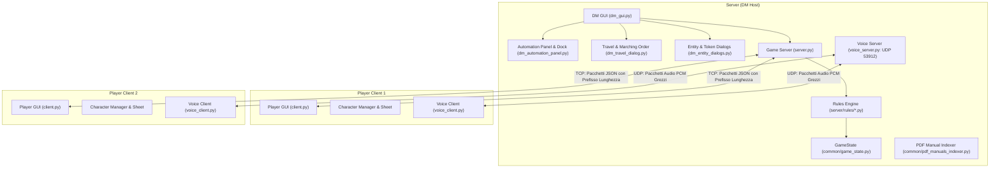

# D&D OmniCompanion — Guida Operativa e Manuale di Sistema

> 🌐 **Lingua / Language**: 🇮🇹 **[Italiano (GUIDA_OPERATIVA.md)](GUIDA_OPERATIVA.md)** | 🇬🇧 **[English (OPERATIONAL_GUIDE.md)](OPERATIONAL_GUIDE.md)**
> 📖 **Manuale Utente Passo-Passo**: Consulta anche la **[Guida Completa all'Utilizzo (GUIDA_ALL_UTILIZZO.md)](GUIDA_ALL_UTILIZZO.md)**.

Benvenuto nel manuale operativo e architetturale di **D&D OmniCompanion**, il Virtual Tabletop (VTT) e motore di gestione campagna sviluppato in Python per Dungeons & Dragons 5a Edizione.

---

## Indice dei Contenuti
1. [Architettura e Modello di Rete](#1-architettura-e-modello-di-rete)
2. [Prerequisiti e Avvio Rapido](#2-prerequisiti-e-avvio-rapido)
3. [Panoramica Interfaccia Utente e Layout](#3-panoramica-interfaccia-utente-e-layout)
4. [Operazioni del Dungeon Master (DM)](#4-operazioni-del-dungeon-master-dm)
   - [Stili di Gestione della Campagna (DM Agency vs Full Automation) e Barra Decisioni](#stili-di-gestione-della-campagna-dm-agency-vs-full-automation-e-barra-decisioni)
   - [Gestione Mappe, Griglia Multi-Scala e Righello](#gestione-mappe-griglia-multi-scala-e-righello)
   - [Porte, Serrature e Scasso RAW 5e](#porte-serrature-e-scasso-raw-5e)
   - [Spille di Stanza del Dungeon (Room Pins) e Boxed Text](#spille-di-stanza-del-dungeon-room-pins-e-boxed-text)
   - [Tiri Segreti del DM (Blind Rolls: /broll, /gmroll)](#tiri-segreti-del-dm-blind-rolls-broll-gmroll)
   - [Nebbia di Guerra, Illuminazione Dinamica e Line of Sight](#nebbia-di-guerra-illuminazione-dinamica-e-line-of-sight)
   - [Trappole, Pericoli e Portali (Teletrasporti)](#trappole-pericoli-e-portali-teletrasporti)
   - [Gestione Combattimento e Bilanciatore Incontri Live](#gestione-combattimento-e-bilanciatore-incontri-live)
   - [Bestiario Mostri e Indicizzatore PDF Offline](#bestiario-mostri-e-indicizzatore-pdf-offline)
   - [Handout e Condivisione Indizi](#handout-e-condivisione-indizi)
   - [Campagne, Scene, Negozi e Quest](#campagne-scene-negozi-e-quest)
   - [Gestione Party e Divisione Bottino](#gestione-party-e-divisione-bottino)
   - [Soundboard Audio](#soundboard-audio)
5. [Operazioni del Giocatore (Player)](#5-operazioni-del-giocatore-player)
   - [Wizard di Creazione e Progressione Personaggio](#wizard-di-creazione-e-progressione-personaggio)
   - [Scheda Personaggio Interattiva](#scheda-personaggio-interattiva)
   - [Sintonia con Oggetti Magici (Attunement `🔮`) e Ispirazione DM](#sintonia-con-oggetti-magici-attunement--e-ispirazione-dm)
   - [Azioni di Combattimento ed Economia del Turno Contestuale](#azioni-di-combattimento-ed-economia-del-turno-contestuale)
   - [Automazione dei Tiri Salvezza contro la Morte](#automazione-dei-tiri-salvezza-contro-la-morte)
   - [Inventario, Ingombro e Approvazione DM Online](#inventario-ingombro-e-approvazione-dm-online)
   - [Grimorio e Gestione Slot Incantesimo](#grimorio-e-gestione-slot-incantesimo)
   - [Scambi Peer-to-Peer tra Giocatori](#scambi-peer-to-peer-tra-giocatori)
   - [Macro Hotbar Rapida](#macro-hotbar-rapida)
   - [Sistema di Viaggio e Ordine di Marcia](#sistema-di-viaggio-e-ordine-di-marcia)
6. [Motore delle Meccaniche e Automazioni D&D 5e](#6-motore-delle-meccaniche-e-automazioni-dd-5e)
   - [Successi Critici (20 Naturale) e Fallimenti Critici (1 Naturale)](#successi-critici-20-naturale-e-fallimenti-critici-1-naturale)
   - [Calcolo di Vantaggio e Svantaggio](#calcolo-di-vantaggio-e-svantaggio)
   - [Reazioni RAW e Incantesimo Scudo (*Shield*)](#reazioni-raw-e-incantesimo-scudo-shield)
   - [Tratti Speciali: Evasione e Attacco Furtivo](#tratti-speciali-evasione-e-attacco-furtivo)
   - [Sistema di Copertura Dinamica](#sistema-di-copertura-dinamica)
   - [Attacchi di Opportunità](#attacchi-di-opportunità)
   - [Prove di Concentrazione](#prove-di-concentrazione)
   - [Assorbimento Danni, Resistenze e Ira Barbarica](#assorbimento-danni-resistenze-e-ira-barbarica)
   - [Riposi e Dadi Vita](#riposi-e-dadi-vita)
7. [Comunicazione e Voice Chat](#7-comunicazione-e-voice-chat)
   - [Chat Ricca Stile Discord](#chat-ricca-stile-discord)
   - [Sussurri Privati](#sussurri-privati)
   - [Voice Chat UDP Integrata](#voice-chat-udp-integrata)
8. [Riferimento Comandi Chat e Scorciatoie](#8-riferimento-comandi-chat-e-scorciatoie)
9. [Internazionalizzazione Bilingue (IT / EN) e Unità di Misura (ft / m)](#9-internazionalizzazione-bilingue-it--en-e-unità-di-misura-ft--m)
10. [Suite di Test e Quality Assurance](#10-suite-di-test-e-quality-assurance)

---

## 1. Architettura e Modello di Rete

D&D OmniCompanion è strutturato attorno a un'architettura Client-Server asincrona che combina la gestione affidabile dello stato via TCP con lo streaming vocale a bassa latenza via UDP.



### Sottosistemi Principali
* **`common/network_utils.py` & `common/protocol.py`**: Framing binario con prefisso di lunghezza a 4 byte su stream socket TCP, per garantire zero frammentazione dei pacchetti JSON indipendentemente dalla latenza o dalla dimensione del payload. Il modulo `protocol.py` include una **tipizzazione statica rigorosa del protocollo (`TypedDict`)** per garantire contratti di payload robusti tra client e server, l'**Isolamento di Rete del GM Layer** (i broadcast di `GAME_STATE`, `PLAYER_JOINED` e `PLAYER_MOVE` escludono automaticamente i token con `layer == "gm"` per i socket dei giocatori) e i messaggi per lavagna tattica, blind rolls (`/broll`), gestione porte e narrazione stanze.
* **`server/dm_automation_panel.py`, `dm_travel_dialog.py`, `dm_entity_dialogs.py`**: Moduli specializzati decongestionati dal controller centrale `dm_gui.py`:
  * `dm_automation_panel.py`: gestisce i 3 profili di conduzione (`🎲 Tavolo Tradizionale`, `⚖️ Ibrido Assistito`, `⚡ Full Automation`), gli 11 toggle granulari e la **Barra Fluttuante delle Decisioni DM in Sospeso** (*Pending Actions Dock*).
  * `dm_travel_dialog.py`: dialoghi interattivi per la marcia via terra, consumo razioni, ruoli di viaggio e ordine di marcia del party.
  * `dm_entity_dialogs.py`: configurazione avanzata di taglia token (da Minuscola a Mastodontica), aure magiche e attributi contestuali.
* **`common/hex_utils.py`**: Motore matematico per griglie geometriche:
  * Sistema di coordinate cubiche ($q, r, s$ con $q + r + s = 0$) con `HexLayout` per griglie esagonali, raycasting Line of Sight (LoS), proiezioni di coni ($60^\circ / 90^\circ$), sfere e linee rette AoE.
  * `SquareLayout` per griglie a scacchiera/quadrate e conversione pixel $\leftrightarrow$ griglia.
  * Funzione polimorfica `grid_distance(a, b, grid_type)` con supporto per metrica di Chebyshev (regola ufficiale D&D 5e per caselle diagonali su griglie quadrate), distanza cubica per esagoni e distanza euclidea per griglie libere (`none`/`gridless`).
* **`server/voice_server.py` & `client/voice_client.py`**: Server di broadcast e client streaming vocale UDP in tempo reale. Su sistemi Windows, il socket UDP è configurato con `SIO_UDP_CONNRESET` per intercettare gli errori ICMP Port Unreachable ed evitare che la disconnessione anomala di singoli client interrompa il loop `recvfrom` del server.
* **`client/client.py`**: Interfaccia principale e loop messaggi asincrono protetto da blocco `try...finally` in `process_queue`, garantendo la riprogrammazione ininterrotta a intervalli regolari (`self.master.after(100, ...)`) a fronte di qualsiasi payload imprevisto.
* **`server/rules/`**: Moduli di regole 5e disaccoppiati:
  * `combat.py`: iniziativa, attacchi, critici automatici entro 5ft su bersagli Incoscienti/Paralizzati, copertura e linea di vista con porte chiuse (`get_effective_map_walls`), resistenze e vulnerabilità bilingue, prompt per reazioni (incantesimo *Scudo*, attacchi di opportunità) con bypass blocco turno (`is_reaction=True`), Evasione e Attacco Furtivo.
  * `movement.py`: movimento esagonale, validazione anti-cheat (verifica privilegi DM con socket di rete attivo), salvaguardia condizioni e PF temporanei sulle trappole, FoW, terreni difficili e teletrasporti tra mappe.
  * `character.py`: assorbimento danni, PV temporanei, prove di concentrazione (TS COS), 0 HP, morte istantanea, TS morte e riposi.
  * `chat.py`: chat Discord-style, formule dadi, critici Nat20/Nat1, sussurri privati e blind rolls (`/broll`, `/gmroll`).
  * `map_interaction.py`: ping, righello, porte interattive, serrature/scasso con arnesi, spille di stanza (*Room Pins*) e narrazione al tavolo.
  * `inventory.py` & `client/character_manager.py`: scambi P2P, negozi, valuta (50 monete = 1 lb), approvazione DM, sintonia magica (`🔮`), contenitori per singolo oggetto (`🎒 Zaino`, `⚔️ Addosso`, `🔮 Borsa Conservante`, `✨ Zaino Pratico`, `🐴 Cavalcatura`), tattica "Sfila lo Zaino a Terra" (PHB p. 190) e Regola Variante di Ingombro 5e (PHB p. 176) con penalità dinamica alla velocità effettiva.
  * `audio.py`: gestione broadcast audio e soundboard.
* **`components/statblock_view.py` (`StatblockCardView`)**: Componente grafico modulare per il rendering Dark Fantasy 5e fedele al formato cartaceo dei manuali. Gestisce tre modalità polimorfiche: **Mostri/PNG** (badge CA/PV/Velocità, tabella caratteristiche, tiri salvezza, abilità, resistenze, tratti, azioni, reazioni, azioni leggendarie), **Oggetti Magici** (rarità, categoria, sintonia e proprietà) e **Incantesimi** (livello, scuola, tempo di lancio, gittata, componenti, durata e scaling superiore). Include pulsanti di azione primari contestuali e scrollbar automatica.
* **`common/srd_offline.py`**: Livello di normalizzazione dati e compendio offline. Include `normalize_ac_value` e `normalize_speed_value` per depurare i payload da artefatti e dizionari annidati (`[{}]`), parsing di stringhe complesse per movimenti multipli (volo, nuoto, scavo, scalata), conversione numerica di Gradi di Sfida frazionari (`"1/8"`, `"1/4"`, `"1/2"`), e arricchimento delle statistiche base di mostri importati da PDF o API esterne.
* **`common/i18n.py`**: Dizionario di traduzione bilingue in tempo reale (`IT`/`EN`), conversione unità Imperiale/Metrica (`ft`/`mi` $\leftrightarrow$ `m`/`km`), localizzazione taglie creature, GM layer, strumenti lavagna e motore di calcolo per scale mappa e tempi di viaggio.

---

## 2. Prerequisiti e Avvio Rapido

### Requisiti
* **Python 3.9+** (testato e verificato fino a Python 3.14).
* Dipendenze principali:
  ```bash
  pip install pillow ttkbootstrap requests sounddevice numpy
  ```
  *(Nota: `sounddevice` e `numpy` sono utilizzati per lo streaming vocale in tempo reale. In ambienti di test headless o privi di PortAudio, viene rispettata automaticamente la variabile d'ambiente `DND_MOCK_AUDIO=1`).*

### Avvio dell'Applicazione
Esegui il launcher unificato dalla radice del progetto:
```bash
python main.py
```
Apparirà il selettore del ruolo:
1. **Dungeon Master**: Avvia il server Host DM sulle porte predefinite `53911` (TCP) e `53912` (UDP) e apre la plancia del DM (con Campagna, Editor Campagna o Sessione Rapida).
2. **Giocatore**: Avvia il client VTT Giocatore, consentendo la creazione/selezione del personaggio e la connessione al server tramite IP/hostname.

---

## 3. Panoramica Interfaccia Utente e Layout

Sia l'interfaccia DM che quella Giocatore sono realizzate con **ttkbootstrap** in stile dark fantasy moderno, organizzate in un layout a 3 colonne ispirato ai moderni VTT e a Discord:

| Colonna | Componente | Scopo |
|---|---|---|
| **Toolbar Sinistra** | Striscia Icone Compatta | Strumenti mappa contestuali (`👆` Seleziona/Centra, `📏` Righello Multi-Scala, `💥` Area d'Effetto, `📍` Ping, `📖` Manuali, `🚪` Teletrasporto, `☁️` Nebbia di Guerra) con tooltip. |
| **Viewport Centrale** | `HexMapCanvas` | Canvas esagonale infinito con zoom e pan, **Initiative Ribbon HUD** in alto al centro durante il combattimento, **HUD Glassmorphism Zoom/Centra** in basso a sinistra, Nebbia di Guerra dinamica, aloni di luce, aure, token, badge condizioni, muri e vettori righello. |
| **Sidebar Destra** | Notebook a Tab | Schede per Chat / Log Dadi, Controlli Vocali, Hero Summary Card & Economia Turno, Tracker Party & PNG, Mondo & Calendario, Bestiario e Audio/SFX. |

* **Tavolozza Comandi Rapida (`Ctrl+K`)**: Premi `Ctrl+K` in qualsiasi momento per cercare regole 5e, mostri, incantesimi, token sulla mappa o eseguire tiri `/roll` istantanei.

### Architettura Mono-Finestra (Single-Window & Decoupled Frame Pattern)

D&D OmniCompanion implementa un pattern architetturale disaccoppiato che consente di utilizzare i componenti dell'interfaccia sia come frame integrati in-place sia come finestre di dialogo indipendenti (`Toplevel`):

1. **Pattern `*Frame` vs `*Dialog`**:
   * I componenti principali dell'interfaccia sono ingegnerizzati ereditando da `ttk.Frame` (o `tk.Frame`), accettando un contenitore `parent` generico e separando la logica di presentazione dal container di primo livello:
     * `CharacterManagerFrame` (in `client/character_manager_ui.py`) $\leftrightarrow$ `CharacterManagerDialog`
     * `CharacterCreationWizardFrame` (in `client/character_creation_wizard.py`) $\leftrightarrow$ `CharacterCreationWizardDialog`
     * `CharacterSheetFrame` (in `client/character_sheet_ui.py`) $\leftrightarrow$ `CharacterSheetDialog`
     * `CampaignEditorFrame` (in `server/campaign_editor_ui.py`) $\leftrightarrow$ `CampaignEditorDialog`
   * I corrispondenti `*Dialog` fungono da leggeri wrapper che creano un `tk.Toplevel`, istanziano il rispettivo `*Frame` ed espongono i metodi delegati, garantendo piena retrocompatibilità.

2. **Navigazione In-Place nel Launcher (`main.py`)**:
   * Il launcher unificato gestisce la navigazione tra le schermate tramite un container a vista singola. Quando l'utente seleziona un'opzione (es. Gestione Personaggi o Editor Campagna), il pannello di selezione iniziale viene nascosto (`pack_forget()`) e viene montato il relativo `*Frame`.
   * Un banner persistente in alto (`_build_banner()`) fornisce il pulsante `[ ← Torna al Menu Principale ]` per smontare il frame attivo e ripristinare il selettore dei ruoli.

3. **Center Overlay e Ciclo di Vita Dock/Detach nel Client VTT (`client/client.py`)**:
   * **Center Overlay**: La Scheda PG viene montata dinamicamente come un overlay centrale (`_sheet_overlay_frame`) posizionato sopra il viewport della mappa con `place()`, corredato di barra del titolo con pulsanti `[ ◱ Stacca Finestra ]` e `✖`.
   * **Scorciatoie Globali**: I tasti **`C`** (toggle overlay / riaggancia) ed **`Esc`** (chiudi overlay se attivo) sono agganciati alla toplevel principale (`<c>`, `<C>`, `<Escape>`).
   * **Stacco (`detach_character_sheet()`)**: Distrugge il frame overlay interno, crea un nuovo `tk.Toplevel` (`_sheet_window`), istanzia `CharacterSheetFrame` nella nuova finestra e aggiunge il pulsante `[ ◰ Riaggancia alla Mappa ]`.
   * **Riaggancio (`dock_character_sheet()`)**: Chiude in modo pulito la finestra staccata e ricrea l'overlay centrale sulla mappa, garantendo la totale continuità dello stato del personaggio.

---

## 4. Operazioni del Dungeon Master (DM)

### Stili di Gestione della Campagna (DM Agency vs Full Automation) e Barra Decisioni
Il server implementa un'architettura granulare per arbitrare il livello di automazione delle regole 5e, disaccoppiata in `server/dm_automation_panel.py` e integrata nel `GameState`:
* **Modello Dati**:
  * `GameState.automation_profile`: memorizza il profilo globale attivo (`"traditional"`, `"hybrid"`, `"full"`).
  * `GameState.automation_toggles`: dizionario di 11 flag booleani indipendenti (`auto_attack_damage`, `auto_aoe_damage`, `auto_concentration`, `auto_advantage_disadvantage`, `auto_critical_damage`, `auto_traps`, `auto_turn_economy`, `auto_spell_slots`, `auto_encumbrance`, `auto_death_saves`, `auto_weather_effects`).
* **Profili Operativi**:
  * **`🎲 Tavolo Tradizionale`**: Mantiene il controllo completo nelle mani del DM. Gli attacchi e le magie calcolano i valori matematici ma non alterano i PV senza l'approvazione del Master; le porte e i tiri salvezza lasciano spazio alla narrazione; nessun muro invisibile blocca i token.
  * **`⚖️ Ibrido Assistito`**: Ideale per la maggior parte dei tavoli. Risolve automaticamente le regole complesse (coperture, resistenze, condizioni, formule) e inoltra le richieste critiche (danni ai PG, eventi di morte) alla barra decisioni.
  * **`⚡ Full Automation`**: Modalità videogioco tattico. Danni sottratti istantaneamente, turni rigidamente bloccati per chi non è attivo, reazioni e trappole automatiche.
* **Barra Decisioni DM in Sospeso (*Pending Actions Dock*)**:
  * Un componente dock flottante semi-trasparente posizionato in basso al centro della schermata del DM.
  * Quando un'azione richiede arbitraggio, viene generata una card con anteprima e pulsanti di risoluzione a 1-click: `[ ✅ Applica ]`, `[ ✂️ Dimezza ]`, `[ ✏️ Modifica ]`, `[ ❌ Nega ]`.

### Gestione Mappe, Griglia Multi-Scala e Righello
* **Caricamento Mappe**: Vai su `File -> Carica Mappa`. Formati supportati: `.png`, `.jpg`, `.jpeg`, `.json`.
* **Motore Multi-Griglia (Esagonale, Quadrata, Senza Griglia)**:
  * **Griglia Esagonale (`hex`)**: coordinate cubiche e orientamento flat-topped/pointy-topped.
  * **Griglia a Scacchiera / Quadrata (`square`)**: mappatura matriciale e calcolo distanze con metrica di Chebyshev standard D&D 5e (le diagonali contano come 1 passo standard da 5 ft).
  * **Senza Griglia (`none` / `gridless`)**: sopprime la griglia grafica per mappe illustrative; il movimento calcola la distanza euclidea reale.
  * **Selettore Rapido Griglia (`📐 Griglia`)**: pulsante dinamico sulla barra superiore del DM per cambiare in tempo reale la tipologia di griglia della mappa attiva.
* **Motore Mappa Multi-Scala (DMG p. 14)**:
  * **Scala Combattimento** (`hex_size=30` o `60`): $1\text{ hex} = 5\text{ ft}$ ($1.5\text{ m}$).
  * **Scala Esplorazione / Provincia** (`hex_size=35`): $1\text{ hex} = 1\text{ mi}$ ($1.5\text{ km}$, $\sim 20\text{ min}$ di marcia/hex).
  * **Scala Mondo / Regione** (`hex_size=15`): $1\text{ hex} = 6\text{ mi}$ ($9\text{ km}$, $2\text{ ore}$ di marcia/hex; $4\text{ hex} = 1\text{ giorno}$).
  * **Scala Personalizzata**: Qualsiasi valore di distanza e unità (`ft`, `m`, `mi`, `km`) per esagono.
  * **Selettore Rapido Scala (`📏 Scala`)**: Clicca sul badge della scala nella barra superiore del DM per cambiare al volo la scala della mappa attiva e trasmetterla in tempo reale a tutti i giocatori connessi.
* **Editor Mappe**: Scegli `Strumenti -> Editor Mappe` per configurare raggio celle, tipo di griglia (`grid_type`), offset, scala, muri statici, trappole, portali e luci.

### Porte, Serrature e Scasso RAW 5e
* **Stati Porte**: `open` (aperta), `closed` (chiusa), `locked` (chiusa a chiave con CD), `secret` (segreta), `barred` (sbarrata dall'interno).
* **Meccanica di Scasso RAW (PHB p. 154)**:
  * Richiede *Arnesi da Scasso* nell'inventario del PG.
  * Prova di Destrezza con bonus competenza contro la CD della serratura.
  * Supporto per tentativi di forzatura con prova di Forza (Atletica) e apertura magica con incantesimo *Scassinare* (*Knock*).
* **Integrazione con i Profili di Automazione**: Con il profilo *Tradizionale*, il tentativo di scasso richiede l'arbitraggio del DM nella barra decisioni per descrivere l'esito narrativo o applicare imprevisti.

### Spille di Stanza del Dungeon (Room Pins) e Boxed Text
* **Spille Interattive (`[ 📌 ]`)**: Il DM può posizionare spille numerate o titolate sulla mappa collegate ai paragrafi dell'avventura.
* **Boxed Text Narrativo**: Riquadro formattato di narrazione ambientale che il DM può leggere a voce o trasmettere istantaneamente con un click (**`📢 Leggi al Tavolo`**) in chat come pergamena condivisa.
* **Note Segrete del DM**: Area protetta per trappole celate, tattiche dei mostri, tesori nascosti e CD di investigazione, visibile esclusivamente al Master.

### Tiri Segreti del DM (Blind Rolls: `/broll`, `/gmroll`)
* **Comandi Chat**: `/broll <formula> [motivo]` o `/gmroll <formula> [motivo]`.
* **Sicurezza Anti-Metagame**: Il server calcola il tiro con il motore matematico di `common/dice.py`. Il valore del dado, i modificatori e il totale sono inviati via TCP solo al socket del DM (`BLIND_ROLL_DM_NOTIFY`). Il giocatore riceve una notifica di avvenuto invio senza conoscere il numero uscito.

### Nebbia di Guerra, Pennello Manuale, Luci e Line of Sight
* **Nebbia di Guerra Dinamica (FoW)**: Il canvas nasconde automaticamente le celle inesplorate ai giocatori.
* **Pennello Manuale FoW (`Raggio: 0, 1, 2, 3`)**: Nel pannello FoW (`[ ☁️ ]`), il DM può selezionare un raggio circolare e cliccare sulla mappa con tasto sinistro (scopri) o tasto destro (nascondi) per dipingere o ripristinare la nebbia su gruppi di celle contigue.
* **Visione Condivisa del Party**: Man mano che un token del party si muove, le celle entro il suo raggio visivo vengono rivelate.
* **Illuminazione Dinamica**: I token che portano fonti di luce (es. Torce: 20 ft intensa / 20 ft fioca; Lanterne: 30 ft intensa / 30 ft fioca) illuminano dinamicamente in tempo reale.
* **Filtro Oscurità (`[ 🌑 ]`) & Oscurità Magica**:
  * Toggle a 1-click sulla toolbar del DM (`[ 🌑 ]`) o comando chat `/darkness` / `/oscurita`: immerge l'intera mappa nell'oscurità totale (`#000000`).
  * Regole di visibilità dinamica: le celle non illuminate da torce/lanterne o scurovisione appaiono oscurate.
  * Sfere di Oscurità Magica: posizionabili con click destro sulla mappa $\rightarrow$ `🌑 Piazza Sfera di Oscurità Magica (R=3)`. La normale Scurovisione non penetra l'oscurità magica (PHB p. 194-195).
* **Line of Sight Reale (LoS)**: Il raycasting geometrico valuta la linea di tiro/vista bloccandola contro i muri (`wall_hexes`).

### Taglie Creature e Livello Nascosto DM (GM Layer)
* **Taglie Ufficiali 5e**: Supporto nativo per le 6 taglie (**Minuscola**, **Piccola**, **Media**, **Grande**, **Enorme**, **Mastodontica**), con scalatura visiva automatica del raggio token sul canvas da $0.5\times$ a $3.5\times$. Configurazione rapida con click destro sul token $\rightarrow$ `Taglia Creatura (Size)`.
* **Livello Nascosto DM (GM Layer)**:
  * Consente di nascondere token mostri o trappole ai client giocatori.
  * Rendering DM: token semitrasparente con anello viola tratteggiato e badge `[GM]`.
  * Filtro Sicurezza Rete: a livello di protocollo TCP (`network_utils.py` e `game_state.py`), i pacchetti `GAME_STATE`, `PLAYER_JOINED` e `PLAYER_MOVE` escludono integralmente le entità con `layer == "gm"` per i socket dei giocatori, garantendo zero fughe di metagame.
  * Attivazione/disattivazione rapida con click destro sul token $\rightarrow$ `👁️ Livello DM (GM Layer)`.

### Trappole, Terreni Difficili, Pericoli e Portali (Teletrasporti)
* **Trappole**: Quando un token entra in un esagono trappola, il server:
  1. Confronta la Percezione Passiva con la CD di Individuazione della trappola.
  2. Se attivata, calcola il danno e richiede al giocatore un Tiro Salvezza su Destrezza.
  3. Rivela visivamente la trappola sulla mappa con un avviso in chat.
* **Terreni Difficili e Pericolosi (Hazard)**:
  * 5 tipologie con texture e colori distintivi: **Fango** (`mud`), **Ghiaccio Scivoloso** (`ice`), **Rovi Spinosi** (`briars`), **Macerie** (`rubble`), **Palude Profonda** (`swamp`).
  * **Movimento Rallentato**: Il calcolo di percorso (`hex_linedraw`) applica costo di movimento $\times 2$ (cumulativo con la condizione `Prono`).
  * **Pericoli all'Ingresso**: Entrare in un esagono di Ghiaccio richiede un Tiro Salvezza su Destrezza con CD 10 per non cadere Prono; entrare nei Rovi infligge automaticamente $1d4$ danni perforanti con avviso in chat.
  * **Applicazione al Volo e Pennello DM**: Il DM può applicare terreni con click destro sull'esagono $\rightarrow$ `🌾 Terreno Difficile...` oppure tramite il pannello pennello `[ 🪨 ]` sulla toolbar sinistra (raggio 0, 1, 2 con selezione tipologia).
* **Portali e Teletrasporti**: Cliccando su `[ 🚪 ]` nella toolbar del DM è possibile associare una coordinata esagonale (es. `5,5`) a un file mappa di destinazione (es. `dungeon_level2.json`). Quando un token calpesta l'esagono, il server trasferisce automaticamente il party sulla nuova mappa.

### Gestione Combattimento e Bilanciatore Incontri Live
1. **Avvio del Combattimento**: Clicca su **Inizia Combattimento** nel tab `Iniziativa & PG`.
2. **Iniziativa Mostri di Massa**: Il DM può cliccare su **🎲 Tira Iniziativa Mostri** per tirare istantaneamente l'iniziativa di tutti i mostri nello scontro applicando i modificatori di Destrezza.
3. **Rotazione dei Turni**: Usa **Prossimo Turno ⏩** o **⏪ Turno Precedente** per avanzare nell'ordine d'iniziativa. Il token attivo è evidenziato con un doppio anello dorato sulla mappa e nel **Ribbon HUD** superiore.
4. **Calcolatore Difficoltà Incontri Live (DMG p. 82)**:
   * Il pannello DM somma dinamicamente i livelli dei giocatori e i Gradi di Sfida (CR) dei mostri.
   * Calcola gli XP rettificati usando i moltiplicatori 5e per numero di mostri (da $1.5\times$ a $4\times$).
   * Mostra in tempo reale la difficoltà: **Banale**, **Facile**, **Medio**, **Difficile** o **Mortale**.
5. **Meccaniche Boss e Azioni Leggendarie**:
   * **Resistenze Leggendarie**: I mostri dotati di resistenze leggendarie (es. 3/giorno) possono trasformare un Tiro Salvezza fallito in un successo con 1 click.
   * **Azioni Leggendarie**: Spendi punti azione leggendaria fuori dal turno del boss, con reset automatico all'inizio di ogni round.

### Bestiario Mostri, Compendio Split View e Indicizzatore PDF Offline
* **Compendio & SRD Split View (`server/compendium_ui.py`)**:
  * **Architettura Master-Detail**: pannello diviso tramite `ttk.PanedWindow` orizzontale o contenitore a griglia a 2 colonne. La colonna di sinistra ospita la barra di ricerca, i controlli di filtraggio rapido (CR, tipo creatura, rarità) e la `ttk.Treeview`/`tk.Listbox` con indicazione del numero di risultati. La colonna di destra ospita l'istanza di `StatblockCardView` con scrolling reattivo e canvas dedicato.
  * **Rendering Statblock 5e Integrato**: renderizza attributi numerici e descrittivi estratti dalle API o dai manuali PDF con tipografia ad alto contrasto dark fantasy.
  * **Spawning ed Integrazione di Rete**: il pulsante primario richiama `on_monster_spawned` su `DM_GUI`, instanziando l'entità come `Player` (`is_party_member=False`) con coordinate sull'ultimo esagono cliccato o al centro del viewport e trasmettendo il broadcast `PLAYER_JOINED` e `PLAYER_STATS_UPDATE` a tutti i client connessi.
* **Pannello Bestiario DM (`server/dm_bestiary_panel.py`)**:
  * Componente integrato nella sidebar destra del DM. Include pulsanti di filtraggio rapido per Grado di Sfida (*Tutti, 0-1/2, 1-4, 5-9, 10-14, 15-19, 20+*) e Tipo Creatura (*Drago, Non Morto, Umanoide...*).
  * **Mini-Statblock e Preview Reattiva**: visualizza istantaneamente un sommario completo con badge CA/HP/Velocità e tabella caratteristiche essenziali, mantenendo retrocompatibilità completa con `self.bestiario_preview`.
  * **Spawning Diretto**: doppio click su qualsiasi mostro per schierarlo all'istante sulla mappa senza dover aprire finestre secondarie.
* **Pipeline di Normalizzazione Dati (`common/srd_offline.py`)**:
  * `normalize_ac_value`: converte rappresentazioni eterogenee (interi, dizionari con chiavi `'value'`/`'type'`, liste di dizionari JSON grezze) in stringhe eleganti conformi ai manuali (es. `18 (armatura a piastre)`).
  * `normalize_speed_value`: parsa dizionari con chiavi `"walk"`, `"fly"`, `"swim"`, `"burrow"`, `"climb"`, garantendo una visualizzazione multi-movimento chiara sia nella scheda DM che su mappa.
* **Indicizzatore PDF Offline (`common/pdf_manuals_indexer.py`)**: Cerca istantaneamente offline all'interno dei manuali PDF ufficiali indicizzati nella cache `manuals/pdf_index_cache.json`.

### Handout e Condivisione Indizi
* Apri `Strumenti -> Condividi Documento testuale` o `Condividi Immagine (Handout)`.
* Trasmette immediatamente a tutti i client connessi una finestra modale in stile pergamena o l'illustrazione condivisa.

### Campagne, Scene, Negozi e Quest
* **Gestore Campagne e Scene**: Prepara gli incontri in anticipo come "Scene" collegate a mappe e mostri specifici.
* **Sistema Negozi ed Economia**: Apri empori di mercanti dove i giocatori possono consultare merci e acquistare equipaggiamento.
* **Quest Log**: Traccia missioni Attive, Completate e Fallite con ricompense.

### Gestione Party e Divisione Bottino
* **Separazione Party vs PNG**: Fuori dal combattimento, la lista del DM separa `--- MEMBRI DEL PARTY ---` e `--- PNG & MOSTRI ---`.
* **Dividi Denaro**: Clicca su **💰 Dividi Denaro** e inserisci l'ammontare di Monete d'Oro (MO) da dividere equamente tra tutti i membri del party.

### Soundboard Audio
* Il tab `Audio / SFX` fornisce pulsanti di broadcast immediato per musiche d'ambiente ed effetti sonori riprodotti in sincronia sui client.

### Lavagna Tattica Condivisa (Whiteboard) ed Esportazione Session Log
* **Lavagna Tattica Condivisa (`[ ✏️ ]` / `[ 🗑️ ]`)**: disegno a mano libera condiviso broadcastato in real-time a tutti i client. Pulsante di pulizia immediata con notifica TCP di reset.
* **Esportazione Registro di Sessione (`File -> 📜 Esporta Registro di Sessione...`)**: esporta l'intero transcript della sessione (tiri, attacchi, chat, sussurri) in formato Markdown (`.md`) o HTML.

---

## 5. Operazioni del Giocatore (Player)

### Wizard di Creazione e Progressione Personaggio
* **UI Stile Baldur's Gate in 5 Passi**:
  * **Passo 1: Razza**: Selezione delle 9 razze canoniche 5e con matrice statistiche, longevità, sensori speciali, resistenze e sinergie. Include il **Compendio Comparativo Avanzato Master-Detail (`[ 📊 Tabella Comparativa ]`)** con ricerca live, filtri tematici a 1-click (`[Tutte]`, `[🛡️ Resistenze]`, `[👁️ Scurovisione]`, `[🏃 Taglia Piccola]`, `[⚔️ Mischia]`, `[✨ Magiche]`), tabella master a 6 colonne con scroll bidirezionale, anteprima reattiva a destra (lore, resistenze, sinergie, tratti completi e sottorazze) e selezione a doppio click.
  * **Passo 2: Classe**: Selezione delle 12 classi canoniche 5e con Dado Vita ($1\text{d6}$–$1\text{d12}$), Caratteristiche Primarie, Tiri Salvezza, Ruolo, consigli Quick Build ed equipaggiamento di partenza. Include il **Compendio Comparativo Classi** con filtri per categoria (`[Tutte]`, `[Marziali]`, `[Incantatori]`, `[Ibridi]`, `[Esperti]`).
  * **Passo 3: Caratteristiche**: Standard Array, Point Buy (27 punti) o Tiro Dadi (4d6 drop lowest) con applicazione automatica dei bonus razziali.
  * **Passo 4: Background**: Competenze, lingue ed equipaggiamento di background.
  * **Passo 5: Dettagli, Avatar & Token**: Assegnazione nome, divinità, note e caricamento dell'avatar.
* **Avatar Personaggio & Generazione Automatica Token su Mappa**:
  * L'immagine caricata per il personaggio (o per PNG e mostri dal DM) viene automaticamente trasformata nel **Token Grafico Tattico renderizzato sul Canvas Mappa**, con ritaglio circolare antialiased, anello colorato coordinato alla fazione/classe e scalatura automatica in base alla Taglia della creatura (da *Minuscola* $0.5\times$ a *Mastodontica* $3.5\times$).
* **Wizard di Level-Up**:
  * Calcola l'aumento dei PV (tiro del Dado Vita o media fissa).
  * Recupera automaticamente dal compendio SRD i privilegi di classe del nuovo livello e popola sia `features` che `features_list` con sincronizzazione immediata sul modello dati per scongiurare qualsiasi perdita di capacità al salvataggio della scheda.
  * Gestisce gli Aumenti dei Punteggi di Caratteristica (ASI) o Talenti, imponendo il **tetto massimo di 20** per i punteggi di caratteristica ed escludendo la selezione duplicata nella modalità +1/+1.
  * Ricalcola istantaneamente il bonus di competenza ($2 + \lfloor(\text{Livello}-1)/4\rfloor$) e aggiorna tiri salvezza, prove di abilità e attacchi.
  * Sblocca le progressioni di slot incantesimo aggiornate, includendo le tabelle dedicate per **Artefice** (2 slot al 1° livello) e **Terzi Incantatori** (*Cavaliere Mistico* e *Mistificatore Arcano* dal 3° livello).

### Scheda Personaggio Interattiva
Organizzata in schede chiare:
* **Tab Combattimento & Statistiche**: PV attuali/massimi con barra proporzionale, PV Temporanei, CA, Velocità, Iniziativa, Condizioni attive, Tiri contro la Morte, Dadi Vita, le 6 caratteristiche base, Tiri Salvezza e tutte le 18 Abilità con Competenza/Maestria.
* **Tab Armi & Attacchi**: Gestione armi equipaggiate e tiri rapidi per colpire/danni.
* **Tab Inventario**: Inventario con pesi, quantità, oggetti sintonizzati (`🔮` max 3), Borsa delle Monete e peso totale rispetto alla capacità di carico ($\text{FOR} \times 15\text{ lbs}$).
* **Tab Grimorio**: Slot incantesimo di livello 1–9 con contatori attuali/massimi, ricerca incantesimi, dialog modale di **Upcasting** e lancio con 1 click.
* **Tab Privilegi & Diario**: Tratti razziali, privilegi di classe, tracciatore **Risorse di Classe Speciali** e note personali.

### Sistema Risorse di Classe Speciali
* **Automazione di Classe**: All'atto della creazione o level-up, il sistema popola automaticamente le risorse caratteristiche della classe scelta (es. *Punti Ki*, *Ira*, *Ispirazione Bardica*, *Forma Selvatica*, *Canale di Divinità*, *Azione Impetuosa*, *Secondo Fiato*, *Punti Stregoneria*, *Imposizione delle Mani*).
* **Contatori Interattivi**: Controlli `[-]` / `[+]` per spendere o ripristinare cariche istantaneamente.
* **Risorse Custom**: Possibilità di aggiungere risorse arbitrarie con Nome, Massimo e Regola di Recupero (*Riposo Breve* vs *Riposo Lungo*).
* **Recupero Automatico**: Durante un Riposo Breve o Lungo, il motore aggiorna le sole risorse congruenti con la tipologia di riposo effettuato.

### Sintonia con Oggetti Magici (Attunement `🔮`) e Ispirazione DM
* **Sintonia Magica (DMG p. 136)**:
  * Tracciamento rigoroso del vincolo a un massimo di **3 oggetti magici sintonizzati** per personaggio.
  * Gli oggetti sintonizzati applicano automaticamente i modificatori alle statistiche, alla CA e ai tiri per colpire/danni.
  * Il tentativo di sintonizzare un quarto oggetto richiede prima di interrompere una sintonia esistente durante un riposo breve.
* **Ispirazione del DM**:
  * Badge di stato visibile nella testata della scheda e nella summary card (`✨`).
  * Il DM può conferirla con 1 click o revocarla.
  * Il giocatore può spendere l'Ispirazione per applicare automaticamente Vantaggio (`2d20kh1`) al prossimo tiro per colpire, tiro salvezza o prova.

### Azioni di Combattimento ed Economia del Turno Contestuale
Il pannello **Economia Turno** del Giocatore si adatta automaticamente allo stato del combattimento:
* **Fuori dal Combattimento (`🧭 Modalità Esplorazione - Movimento Libero`)**:
  * I badge (`⚡ Azione`, `✨ Bonus`, `🛡️ Reazione`) restano in modalità `Libera (Esplorazione)` e non vengono mai bloccati quando ci si muove, si attacca o si lanciano incantesimi fuori dal combattimento.
  * La barra del movimento mostra la velocità per singolo spostamento (`👟 Velocità: 30 ft / 9 m (Libero)`).
* **Durante il Combattimento (`Economia Turno`)**:
  1. **Notifica del Turno**: Appaiono il banner visivo, la freccia `▼` sull'**Initiative Ribbon HUD** e il toast ("È IL TUO TURNO!"). Tutte le risorse del turno si resettano automaticamente tramite `TURN_ECONOMY_UPDATE`.
  2. **Movimento**: Clicca sull'esagono di destinazione (il percorso è validato rispetto alla velocità residua; la condizione `Prono` raddoppia il costo di movimento).
  3. **Menu Azione**: Clicca su `Azione` per scegliere le azioni standard 5e (**Attacco**, **Lancia Incantesimo / AoE**, **Scatto**, **Disimpegno**, **Schivata**, **Aiuto**).
  4. **Termina Turno**: Clicca su `Termina Turno` per passare l'iniziativa al combattente successivo.

### Automazione dei Tiri Salvezza contro la Morte
* Se inizi il tuo turno a **0 PV**:
  * Si apre automaticamente la richiesta di Tiro Salvezza contro la Morte (eseguibile anche con `/tsmorte`, `/deathsave` o `/ds`).
  * **20 Naturale**: Recuperi immediatamente 1 PV e rimuovi la condizione `Incosciente`.
  * **Tiro $\ge 10$**: +1 Successo (a 3 successi ottieni la condizione `Stabilizzato`).
  * **Tiro $< 10$**: +1 Fallimento.
  * **1 Naturale**: Conta come **2 Fallimenti** (a 3 fallimenti ottieni la condizione `Morto`).
* **Subire Danni a 0 PV**: Subire danni a 0 PV assegna automaticamente **1 fallimento** ai tiri contro la morte (o **2 fallimenti** se l'attacco subito è un Colpo Critico).
  * **Morte Permanente & Spoglie del Cadavere**: Al terzo fallimento accumulato, il personaggio riceve lo status `💀 Morto`; il server genera automaticamente un token cadavere interattivo sul terreno di scontro con bottino ed equipaggiamento recuperabile dal party.
  * **Cure a 0 PV**: Ricevere una guarigione a 0 PV ripristina i Punti Ferita, azzera completamente i successi e fallimenti dei tiri salvezza contro la morte, e rimuove all'istante le condizioni `Incosciente` e `Stabilizzato`.
  * **Morte Istantanea**: Un danno in eccesso pari o superiore ai PV Massimi causa la morte istantanea immediata.

### Inventario, Ingombro e Approvazione DM (Online & Offline)
* **Regole di Approvazione Master Anti-Cheat (Online & Offline)**:
  * **Blocco Aggiunta/Rimozione Autonoma da SRD**: I giocatori non possono inserire o rimuovere arbitrariamente oggetti nell'inventario o incantesimi nel grimorio tramite il compendio SRD senza l'approvazione del Dungeon Master.
  * Questa regola architetturale è attiva **sia durante le sessioni multiplayer connesse, sia in modalità offline durante la gestione del personaggio**, prevenendo qualsiasi alterazione arbitraria delle schede. Ogni richiesta genera un evento di approvazione formale inviato al server (`ITEM_APPROVAL_REQUEST` / `SPELL_APPROVAL_REQUEST`).
* **Sincronizzazione Valute & Peso Reale Corretto**:
  * **Sincronizzazione Bidirezionale**: Le monete (`MR`, `MA`, `ME`, `MO`, `MP`) sono sincronizzate in tempo reale tra la borsa nell'inventario e la tabella superiore delle valute.
  * **Calcolo Dinamico del Peso**: Il peso totale dell'inventario somma fedelmente tutti gli oggetti fisici trasportati e il peso reale delle monete secondo la regola ufficiale 5e ($50\text{ monete} = 1\text{ lb}$).
* **Gestione Contenitori & Spazi Extradimensionali**:
  * Collocazione immediata a `🎒 Zaino`, `⚔️ Equipaggiato`, `🔮 Borsa Conservante`, `✨ Zaino Pratico`, o `🐴 Cavalcatura`. Il carico all'interno di borse extradimensionali (fino a 500 lbs) non grava sul peso corporeo del personaggio.
* **Materiali di Consumo Spendibili & Pozioni di Cura (`[-1]` / `[+1]`)**:
  * Pulsanti inline direttamente sulla riga dell'oggetto per munizioni, pozioni, torce e razioni per spendere o reintegrare cariche con 1 click. L'uso di pozioni o rimedi curativi aggiorna immediatamente i PV numerici e la barra sulla scheda e sincronizza i dati con il server di gioco.
* **Scambi Peer-to-Peer Sicuri (Anti-Duplicazione)**:
  * Il trasferimento diretto di oggetti o monete tra giocatori svuota preventivamente lo slot nell'inventario del mittente prima dell'invio del pacchetto di rete, eliminando qualsiasi vulnerabilità di duplicazione di oggetti in condizioni di latenza.
* **Diario e Note con Markdown & Convalida Master**:
  * Il diario di campagna e le note personali supportano il rendering visivo nativo in Markdown (`**grassetto**`, `*corsivo*`, elenchi, titoli). Le modifiche richiedono la convalida del Master per garantire l'integrità della cronologia di gioco.

### Grimorio, Gestione Slot e Spell Upcasting
* Aggiungi incantesimi tramite il browser SRD integrato.
* **Upcasting Automatico**: Cliccando su **Lancia** su un incantesimo di 1° livello o superiore, si apre un dialog modale con gli slot disponibili dal livello base al 9°. Selezionando uno slot superiore, il server deduce lo slot appropriato e annuncia in chat sia il livello base sia il livello dell'upcast.
* Il **Riposo Lungo** ripristina tutti gli slot incantesimo al massimo.

### Esportazione Scheda Personaggio (PDF Ufficiale & JSON)
* **Pulsante `📥 Esporta Scheda...`**:
  * **PDF Ufficiale**: Richiede in input di selezionare il file modello PDF vuoto (es. `dnd_blankcharactersheet_it.pdf`) e compila direttamente la scheda a 3 pagine con tutte le statistiche, abilità con cerchietti di competenza, dadi vita, armi, monete, inventario, note e grimorio. Pronto per la stampa o l'archiviazione.
  * **JSON**: File strutturato per backup, migrazione o modifiche testuali.

### Scambi Peer-to-Peer tra Giocatori
* Trasferisci oggetti e monete d'oro direttamente a un compagno di gruppo dalla scheda inventario.

### Macro Hotbar Rapida
* 10 slot rapidi personalizzabili nella parte inferiore del pannello giocatore (**Click Destro** per configurare, **Click Sinistro** per eseguire).

### Sistema di Viaggio e Ordine di Marcia
* Imposta l'ordine di marcia del party (**Avanguardia**, **Centro**, **Retroguardia**), assegna i ruoli di viaggio (Navigatore, Esploratore, Foraggiatore), traccia razioni/acqua e calcola i Tiri Salvezza su Costituzione per la Marcia Forzata ($\text{CD} = 10 + 1\text{ per ogni ora oltre le 8}$).

---

## 6. Motore delle Meccaniche e Automazioni D&D 5e

### Successi Critici (20 Naturale) e Fallimenti Critici (1 Naturale)
Il motore dei dadi (`roll_dice_detailed`) analizza tutti i tiri di `d20` (inclusi Vantaggio `2d20kh1` e Svantaggio `2d20kl1`):
* **Tiri per Colpire (Attacchi)**:
  * **20 Naturale (`🌟 CRITICO NATURALE 20!`)**: Colpisce automaticamente a prescindere dalla CA del bersaglio e raddoppia tutti i dadi di danno sommando una sola volta i modificatori fissi.
  * **1 Naturale (`💀 FALLIMENTO CRITICO!`)**: Manca automaticamente a prescindere dal bonus di attacco.
  * **Colpi Critici Automatici su Bersagli Incoscienti / Paralizzati (PHB p. 291-292)**: Qualsiasi tiro per colpire a segno entro 5 piedi (1 casella) contro un bersaglio con condizione *Incosciente* o *Paralizzato* diventa automaticamente un Colpo Critico con dadi di danno raddoppiati.
* **Tiri Salvezza, Prove di Abilità e Tiri `1d20` Generici**:
  * Evidenzia `🌟 20 NATURALE!` (oro) e `💀 1 NATURALE!` (cremisi) nel log di chat e invia una notifica toast `CRITICAL_ROLL_BROADCAST` a tutti i client connessi.

### Calcolo di Vantaggio e Svantaggio
Il motore di combattimento calcola dinamicamente vantaggio e svantaggio in base allo stato dei token, alle condizioni ambientali e al terreno:
* **L'attaccante ottiene Vantaggio se**:
  * L'attaccante è `Invisibile`.
  * Il bersaglio è `Trattenuto`, `Paralizzato`, `Incosciente`, `Accecato` o `Pietrificato`.
  * Il bersaglio è `Prono` E l'attacco è in mischia (distanza $\le 1$ esagono).
  * Il bersaglio è intrappolato in un terreno instabile o vincolante (**Rovi Spinosi** o **Fango Profondo**).
  * L'attaccante è immerso nel buio ma è in grado di vedere il bersaglio (tramite **Scurovisione** o perché il bersaglio porta una **fonte di luce attiva** come una Torcia/Lanterna), mentre il bersaglio non vede l'attaccante.
* **L'attaccante subisce Svantaggio se**:
  * L'attaccante è `Accecato`, `Avvelenato`, `Trattenuto` o `Prono`.
  * Il bersaglio è `Prono` E l'attacco è a distanza (distanza $> 1$ esagono).
  * Il bersaglio è `Invisibile`.
  * Il bersaglio ha effettuato l'azione `Schivata` (Dodge).
  * L'attaccante si trova su una superficie scivolosa o instabile (**Ghiaccio**, **Palude**, **Macerie**).
  * **Filtro Oscurità Totale**: L'attaccante non può vedere il bersaglio nel buio.
  * **Condizioni Atmosferiche e Meteo**:
    * **Tempesta** o **Nebbia Fitta**: Svantaggio su tutti gli attacchi a distanza con gittata $> 1$ esagono per scarsa visibilità e venti impetuosi.
    * **Pioggia Battente**: Svantaggio sugli attacchi a distanza con gittata lunga $\ge 4$ esagoni.
    * **Tormenta di Neve**: Svantaggio sugli attacchi a distanza con gittata lunga $\ge 3$ esagoni.
* **Oscurità Magica**: La normale Scurovisione non penetra le sfere di oscurità magica; chiunque si trovi all'interno o attacchi verso l'interno è considerato accecato (PHB p. 194-195).
* **Annullamento Reciproco**: Se sono presenti contemporaneamente fonti di vantaggio e di svantaggio (inclusa la reciproca cecità nel buio totale tra creature prive di scurovisione), queste si annullano producendo un tiro normale, con motivazione dettagliata registrata nel log di combattimento.

### Reazioni RAW e Incantesimo Scudo (*Shield*)
* **Gestione Reazioni (PHB p. 190)**: Monitoraggio centralizzato della spesa della reazione per ciascun combattente.
* **Incantesimo Scudo (*Shield*)**:
  * Evento scatenante (*trigger*): un attacco a segno o un lancio di *Dardo Incantato* contro un bersaglio con la magia memorizzata/preparata e slot $\ge 1$.
  * Il client del difensore riceve una richiesta asincrona di reazione con countdown.
  * In caso di conferma: consumo della reazione, deduzione slot di 1° livello e incremento retroattivo $+5$ CA. Se il nuovo valore di CA supera il tiro per colpire dell'attaccante, l'evento viene ricalcolato come mancato prima dell'assegnazione dei danni.

### Tratti Speciali: Evasione e Attacco Furtivo
* **Evasione (Ladro lv 7+ / Monaco lv 7+)**:
  * Su effetti ad area basati su TS Destrezza (es. *Palla di Fuoco*), il modulo `server/rules/combat.py` applica la riduzione automatica: TS superato = 0 danni; TS fallito = metà danno.
* **Attacco Furtivo (Ladro)**:
  * Riconoscimento automatico delle condizioni 5e (arma accurata o a distanza, vantaggio al tiro OPPURE alleato entro 1 esagono e assenza di svantaggio, 1 volta per round).
  * Applicazione automatica dei dadi bonus scalati per livello (da $1d6$ a $10d6$) nel calcolo del pacchetto di danno.

### Sistema di Copertura Dinamica
* Se un'altra creatura o un ostacolo si trova direttamente sul raggio esagonale tra attaccante e bersaglio, il bersaglio ottiene automaticamente **Mezza Copertura (+2 CA)**.

### Attacchi di Opportunità & Reazioni Fuori Turno
* Quando un token esce dalla portata di mischia (1 esagono) di un nemico adiacente senza aver usato l'azione **Disimpegno**, il server rileva l'apertura di un attacco di opportunità e avvisa il difensore.
* **Bypass del Blocco Turno (`is_reaction=True`)**: Le reazioni legittime (come Attacchi di Opportunità e incantesimo *Scudo*) scavalcano il blocco rigido del turno (`strict_turn_lock`), consentendo di reagire immediatamente durante lo svolgimento del movimento avversario.

### Prove di Concentrazione
* Quando una creatura con la condizione `Concentrazione` subisce danni, il server richiede automaticamente un Tiro Salvezza su Costituzione:
  $$\text{CD} = \max(10, \lfloor\text{Danni} / 2\rfloor)$$
* In caso di fallimento, `Concentrazione` viene rimossa automaticamente e annunciata in chat.

### Assorbimento Danni, Resistenze e Ira Barbarica
* **Punti Ferita Temporanei (Temp HP)**: Assorbono i danni prima che vengano ridotti i PV effettivi.
* **Tipi di Danno e Resistenze Bilingue**: Dimezzamento (resistenza), azzeramento (immunità) o raddoppio (vulnerabilità) calcolati automaticamente tramite mappatura bidirezionale italiano/inglese (`fuoco` $\leftrightarrow$ `fire`, `tagliente` $\leftrightarrow$ `slashing`, `radioso` $\leftrightarrow$ `radiant`, ecc.).
* **Ira Barbarica**: Applica resistenza ai danni contundenti, perforanti e taglienti quando l'Ira è attiva.

### Copertura Tattica 5e RAW (PHB p. 196)
Il motore di combattimento supporta sia la determinazione geometrica automatica sia l'override esplicito della copertura scelta da attaccante o DM:
* **Copertura Automatica**: Traccia la linea di vista (`hex_linedraw`) tra attaccante e difensore calcolando muri, porte chiuse o serrate (`get_effective_map_walls`), ostacoli di mezza copertura e creature interposte (escludendo dal calcolo i token morti e quelli posizionati sul layer GM). Le porte chiuse bloccano interamente la linea di vista per gli attacchi a distanza.
* **Mezza Copertura (`half`)**: $+2$ alla CA del bersaglio e $+2$ ai suoi Tiri Salvezza su Destrezza.
* **Tre Quarti di Copertura (`three_quarters`)**: $+5$ alla CA del bersaglio e $+5$ ai suoi Tiri Salvezza su Destrezza.
* **Copertura Totale (`total`)**: Il bersaglio non può essere preso di mira direttamente da attacchi o incantesimi; l'attacco viene completamente bloccato.

### Concentrazione Rigorosa e Spell Upcasting (PHB p. 201-204)
* **Concentrazione Unica**: Il Grimorio rileva se la magia da lanciare richiede concentrazione. Se il personaggio ha già lo status `"Concentrazione"`, la concentrazione precedente viene automaticamente interrotta e notificata in chat con broadcast a tutti i client, impedendo concentrazioni multiple illegali.
* **Tiri Salvezza su Concentrazione**: Subire danni mentre si è concentrati attiva automaticamente un Tiro Salvezza su Costituzione con $\text{CD} = \max(10, \lfloor\text{Danni}/2\rfloor)$. In caso di fallimento, la concentrazione cade e le AoE persistenti collegate vengono rimosse dalla mappa.
* **Spell Upcasting**: Il client consente di selezionare uno slot di livello $\ge$ a quello base della magia, deducendo la risorsa scelta e notificando il livello effettivo in chat.

### Azioni Leggendarie e Azioni di Tana per Boss (MM p. 11)
* **Azioni Leggendarie**: Fino a 3 azioni spendibili per round solo al termine del turno di un'altra creatura. Il server invia un promemoria al DM ad ogni fine turno altrui se il boss ha cariche disponibili, e le ripristina all'inizio del turno del boss.
* **Azioni di Tana (Iniziativa 20)**: Le creature con flag `has_lair_actions = True` innescano un avviso broadcast e un promemoria per il DM all'Iniziativa 20 (inizio del round).

### Registro Missioni (Quest Log) e Documenti Condivisi (Handouts)
* **Quest Log Sincronizzato**: Gestito tramite pacchetti `QUEST_ACTION_REQUEST` (azioni: `add`, `complete`, `delete`) e broadcast `QUEST_LIST_UPDATE`. Lo stato delle missioni e le ricompense sono sempre sincronizzati tra tutti i client connessi.
* **Handout su Pergamena**: Il DM può trasmettere pergamene di testo e illustrazioni tramite `HANDOUT_SHARE_REQUEST` con broadcast globale `HANDOUT_SHARE_BROADCAST`, aprendo istantaneamente il visualizzatore pergamena su tutti i client.

### Riposo Breve Interattivo e Dadi Vita (PHB p. 186)
* **Spesa Dadi Vita Singoli (`ShortRestDialog`)**: Permette al giocatore di spendere un singolo dado alla volta ($1\text{dY} + \text{Mod COS}$, min 1 recuperato) visualizzando in tempo reale la barra della salute, oppure spendere tutti i dadi residui.
* **Riposo Lungo**: Ripristina tutti i PV, tutti gli Slot Incantesimo, riduce di 1 livello l'indebolimento e recupera fino a metà dei Dadi Vita totali ($\max(1, \lfloor\text{Totale}/2\rfloor)$ come da regole RAW 5e).

---

## 7. Comunicazione e Voice Chat

### Chat Ricca Stile Discord
* Vista messaggi formattata con timestamp, tag colore distinti per annunci DM, log di combattimento, tiri di danno, critici e messaggi dei giocatori.

### Sussurri Privati
* Usa `/w <NomePersonaggio> <Messaggio>` (o `/whisper`, `/sussurra`).
* I sussurri sono instradati esclusivamente tra mittente e destinatario con prefisso `[🔒 Sussurro]`.

### Voice Chat UDP Integrata
* Trasmissione audio a bassa latenza direttamente all'interno del VTT senza software esterni.
* Controlli di muto microfono (`[ 🎤 ]`) e disattivazione audio (`[ 🎧 ]`) integrati nella barra della chat.

---

## 8. Riferimento Comandi Chat e Scorciatoie

### Comandi Chat

| Comando | Descrizione | Esempio |
|---|---|---|
| `/roll <expr>` o `/r <expr>` | Tira dadi con aritmetica | `/roll 2d6+4`, `/r 1d20+7` |
| `/w <nome> <msg>` | Invia un sussurro privato | `/w Gildor Guarda dietro di te` |
| `/whisper <nome> <msg>` | Alias per sussurro privato | `/whisper DM Ho trovato la chiave` |
| `/sussurra <nome> <msg>` | Alias italiano per sussurro | `/sussurra Elidor Ho 3 slot rimasti` |
| `/manuale <termine>` | Ricerca rapida nei manuali PDF 5e indicizzati | `/manuale fireball`, `/manuale stealth` |
| `/rule <termine>` | Alias per ricerca manuali | `/rule grappling` |
| `/broll <expr> [motivo]` | Esegue un tiro segreto visibile solo al DM | `/broll 1d20+5 furtività` |
| `/gmroll <expr> [motivo]` | Alias per tiro segreto al DM | `/gmroll 1d20+3 percezione` |
| `/tsmorte`, `/deathsave`, `/ds` | Esegue un Tiro Salvezza contro la Morte | `/ds` |
| `/vision <nome> <raggio>` | Solo DM: imposta il raggio di scurovisione | `/vision Gildor 12` |
| `/darkness`, `/oscurita` | Solo DM: attiva o disattiva il filtro oscurità globale sulla mappa | `/darkness`, `/oscurita` |
| `/weather <cond>`, `/meteo <cond>` | Solo DM: imposta il meteo dinamico (`clear`, `rain`, `storm`, `snow`, `fog`, `darkness`) | `/weather storm`, `/meteo nebbia` |

### Controlli Canvas e Scorciatoie

| Azione | Controllo | Descrizione |
|---|---|---|
| **Scheda PG (Overlay/Dock)** | `C` | Mostra / Nascondi la Scheda Personaggio (Center Overlay / Riaggancia). |
| **Chiudi Scheda / Overlay** | `Esc` | Chiude la Scheda Personaggio o l'Overlay aperto. |
| **Schermo Intero** | `F11` | Attiva / Disattiva la modalità Schermo Intero (Fullscreen). |
| **Tavolozza Comandi** | `Ctrl + K` | Apre la ricerca universale per regole, mostri, incantesimi, token e tiri. |
| **Pan Mappa** | Click Destro + Trascina o Click Centrale + Trascina | Navigazione fluida dell'inquadratura. |
| **Zoom Mappa** | Rotellina Mouse Su / Giù | Zoom avanti/indietro centrato sul cursore. |
| **Muovi Token** | Click Sinistro + Trascina su Token | Muove il token attivo lungo percorsi esagonali validi. |
| **Ping Mappa** | Click Centrale su Esagono (o `[ 📍 ]`) | Invia un indicatore ping animato a tutti i giocatori. |
| **Misura Distanza** | Clicca `[ 📏 ]` poi Trascina | Distanza multi-scala in esagoni, `ft`/`m` o `mi`/`km` + tempo di viaggio. |
| **Seleziona / Centra** | Clicca `[ 👆 ]` poi Clicca Token | Centra la visuale / seleziona il token. |
| **Posiziona AoE** | Clicca `[ 💥 ]` poi Clicca Esagono Origine | Mostra l'anteprima e posiziona il template dell'incantesimo. |
| **Terreni Difficili** | Clicca `[ 🪨 ]` sulla toolbar sinistra | Apre il popup pennello per dipingere Fango, Ghiaccio, Rovi, Macerie, Palude. |
| **Toggle Oscurità** | Clicca `[ 🌑 ]` sulla toolbar sinistra | Attiva/disattiva con 1-click l'oscurità totale della mappa con regole di visione 5e. |

---

## 9. Internazionalizzazione Bilingue (IT / EN) e Unità di Misura (ft / m)

D&D OmniCompanion offre localizzazione bilingue live e doppio sistema di misurazione:
* **Lingua (`🌐 Lingua / Language`)**: Passa a runtime tra **Italiano 🇮🇹** e **English 🇬🇧** senza riavviare server o client.
* **Unità di Misura (`📏 Unità di Misura` / `📏 Distance Units`)**: Passa a runtime tra **Imperiale (`Piedi / Miglia - ft / mi`)** e **Metrico (`Metri / Chilometri - m / km`)**. Converte automaticamente velocità dei personaggi, barre movimento, scale mappa e letture del righello ($5\text{ ft} = 1.5\text{ m}$).

---

## 10. Suite di Test e Quality Assurance

Il progetto include una suite consolidata nella cartella `tests/` con **273 test automatizzati** che passano al 100% con 0 errori, coprendo unit test headless, smoke test della GUI, architettura mono-finestra e simulazioni di campagna complete:

```powershell
# 1. Esegui l'intera suite di unit test (273 test: righello, critici, mono-finestra, economia turno, unità, inventario, razze/classi)
$env:DND_MOCK_AUDIO="1"; python -m unittest discover tests

# 2. Esegui la suite regole autentiche RAW 5e (Porte, Scasso, Spille Stanza, Reazioni, Scudo, Evasione, Furtivo, Blind Rolls)
$env:DND_MOCK_AUDIO="1"; python -m unittest tests/test_authentic_5e.py

# 3. Esegui i test dell'architettura Mono-Finestra (In-place frames, canvas overlay, docking/detaching, hotkeys C/Esc)
$env:DND_MOCK_AUDIO="1"; python -m unittest tests/test_mono_finestra.py

# 4. Esegui gli smoke test UI su tutte le 19 finestre server e client
$env:DND_MOCK_AUDIO="1"; python tests/test_ui_smoke.py --no-screens

# 5. Esegui la simulazione multiplayer end-to-end completa (53 fasi)
$env:DND_MOCK_AUDIO="1"; python tests/simulate_game_session.py

# 6. Esegui i test del sistema campagne
$env:DND_MOCK_AUDIO="1"; python -m unittest tests/test_campaign_system.py

# 7. Esegui la simulazione live campagna 4 giocatori + DM (11 fasi: join, trappole, combattimento a turni, AdO, morte/spoglie, scambi P2P, level-up, riposo breve)
$env:DND_MOCK_AUDIO="1"; python tests/simulate_4player_campaign.py
```

Tutte le suite di test passano con **0 errori**, garantendo l'affidabilità end-to-end su socket di rete, meccaniche di combattimento e rendering grafico.

