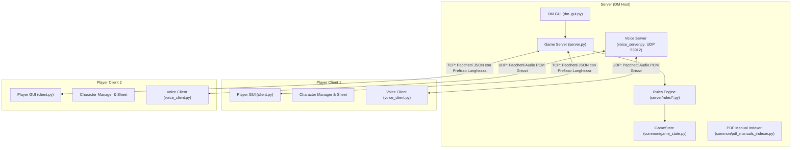

# D&D OmniCompanion — Guida Operativa e Manuale di Sistema

> 🌐 **Lingua / Language**: 🇮🇹 **[Italiano (GUIDA_OPERATIVA.md)](GUIDA_OPERATIVA.md)** | 🇬🇧 **[English (OPERATIONAL_GUIDE.md)](OPERATIONAL_GUIDE.md)**
> 📖 **Manuale Utente Passo-Passo**: Consulta anche la **[Guida Completa all'Utilizzo (GUIDA_ALL_UTILIZZO.md)](GUIDA_ALL_UTILIZZO.md)**.

Benvenuto nel manuale operativo e architetturale di **D&D OmniCompanion**, il Virtual Tabletop (VTT) e motore di gestione campagna sviluppato in Python per Dungeons & Dragons 5a Edizione.

---

## Indice dei Contenuti
1. [Architettura e Modello di Rete](#1-architettura-e-modello-di-rete)
2. [Prerequisiti e Avvio Rapido](#2-prerequisiti-e-avvio-rapido)
3. [Panoramica Interfaccia Utente e Layout](#3-panoramica-interfaccia-utente-e-layout)
4. [Operazioni del Dungeon Master (DM)](#4-operazioni-del-dungeon-master-dm)
   - [Gestione Mappe, Griglia Multi-Scala e Righello](#gestione-mappe-griglia-multi-scala-e-righello)
   - [Nebbia di Guerra, Illuminazione Dinamica e Line of Sight](#nebbia-di-guerra-illuminazione-dinamica-e-line-of-sight)
   - [Trappole, Pericoli e Portali (Teletrasporti)](#trappole-pericoli-e-portali-teletrasporti)
   - [Gestione Combattimento e Bilanciatore Incontri Live](#gestione-combattimento-e-bilanciatore-incontri-live)
   - [Bestiario Mostri e Indicizzatore PDF Offline](#bestiario-mostri-e-indicizzatore-pdf-offline)
   - [Handout e Condivisione Indizi](#handout-e-condivisione-indizi)
   - [Campagne, Scene, Negozi e Quest](#campagne-scene-negozi-e-quest)
   - [Gestione Party e Divisione Bottino](#gestione-party-e-divisione-bottino)
   - [Soundboard Audio](#soundboard-audio)
5. [Operazioni del Giocatore (Player)](#5-operazioni-del-giocatore-player)
   - [Wizard di Creazione e Progressione Personaggio](#wizard-di-creazione-e-progressione-personaggio)
   - [Scheda Personaggio Interattiva](#scheda-personaggio-interattiva)
   - [Azioni di Combattimento ed Economia del Turno Contestuale](#azioni-di-combattimento-ed-economia-del-turno-contestuale)
   - [Automazione dei Tiri Salvezza contro la Morte](#automazione-dei-tiri-salvezza-contro-la-morte)
   - [Inventario, Ingombro e Approvazione DM Online](#inventario-ingombro-e-approvazione-dm-online)
   - [Grimorio e Gestione Slot Incantesimo](#grimorio-e-gestione-slot-incantesimo)
   - [Scambi Peer-to-Peer tra Giocatori](#scambi-peer-to-peer-tra-giocatori)
   - [Macro Hotbar Rapida](#macro-hotbar-rapida)
   - [Sistema di Viaggio e Ordine di Marcia](#sistema-di-viaggio-e-ordine-di-marcia)
6. [Motore delle Meccaniche e Automazioni D&D 5e](#6-motore-delle-meccaniche-e-automazioni-dd-5e)
   - [Successi Critici (20 Naturale) e Fallimenti Critici (1 Naturale)](#successi-critici-20-naturale-e-fallimenti-critici-1-naturale)
   - [Calcolo di Vantaggio e Svantaggio](#calcolo-di-vantaggio-e-svantaggio)
   - [Sistema di Copertura Dinamica](#sistema-di-copertura-dinamica)
   - [Attacchi di Opportunità](#attacchi-di-opportunità)
   - [Prove di Concentrazione](#prove-di-concentrazione)
   - [Assorbimento Danni, Resistenze e Ira Barbarica](#assorbimento-danni-resistenze-e-ira-barbarica)
   - [Riposi e Dadi Vita](#riposi-e-dadi-vita)
7. [Comunicazione e Voice Chat](#7-comunicazione-e-voice-chat)
   - [Chat Ricca Stile Discord](#chat-ricca-stile-discord)
   - [Sussurri Privati](#sussurri-privati)
   - [Voice Chat UDP Integrata](#voice-chat-udp-integrata)
8. [Riferimento Comandi Chat e Scorciatoie](#8-riferimento-comandi-chat-e-scorciatoie)
9. [Internazionalizzazione Bilingue (IT / EN) e Unità di Misura (ft / m)](#9-internazionalizzazione-bilingue-it--en-e-unità-di-misura-ft--m)
10. [Suite di Test e Quality Assurance](#10-suite-di-test-e-quality-assurance)

---

## 1. Architettura e Modello di Rete

D&D OmniCompanion è strutturato attorno a un'architettura Client-Server asincrona che combina la gestione affidabile dello stato via TCP con lo streaming vocale a bassa latenza via UDP.



### Sottosistemi Principali
* **`common/network_utils.py` & `common/protocol.py`**: Framing binario con prefisso di lunghezza a 4 byte su stream socket TCP, per garantire zero frammentazione dei pacchetti JSON indipendentemente dalla latenza o dalla dimensione del payload. Include l'**Isolamento di Rete del GM Layer** (i broadcast di `GAME_STATE`, `PLAYER_JOINED` e `PLAYER_MOVE` escludono automaticamente i token con `layer == "gm"` per i socket dei giocatori) e i messaggi del protocollo di lavagna tattica (`CLEAR_DRAWINGS_REQUEST`, `CLEAR_DRAWINGS_BROADCAST`).
* **`common/hex_utils.py`**: Motore matematico per griglie geometriche:
  * Sistema di coordinate cubiche ($q, r, s$ con $q + r + s = 0$) con `HexLayout` per griglie esagonali, raycasting Line of Sight (LoS), proiezioni di coni ($60^\circ / 90^\circ$), sfere e linee rette AoE.
  * `SquareLayout` per griglie a scacchiera/quadrate e conversione pixel $\leftrightarrow$ griglia.
  * Funzione polimorfica `grid_distance(a, b, grid_type)` con supporto per metrica di Chebyshev (regola ufficiale D&D 5e per caselle diagonali su griglie quadrate), distanza cubica per esagoni e distanza euclidea per griglie libere (`none`/`gridless`).
* **`server/rules/`**: Moduli di regole 5e disaccoppiati che isolano combattimento (`combat.py`), movimento (`movement.py`), danni/morte del personaggio (`character.py`), comandi chat (`chat.py`), inventario/scambi (`inventory.py`), interazioni mappa e lavagna (`map_interaction.py`) e audio (`audio.py`).
* **`common/i18n.py`**: Dizionario di traduzione bilingue in tempo reale (`IT`/`EN`), conversione unità Imperiale/Metrica (`ft`/`mi` $\leftrightarrow$ `m`/`km`), localizzazione taglie creature, GM layer, strumenti lavagna e motore di calcolo per scale mappa e tempi di viaggio.

---

## 2. Prerequisiti e Avvio Rapido

### Requisiti
* **Python 3.9+** (testato e verificato fino a Python 3.14).
* Dipendenze principali:
  ```bash
  pip install pillow ttkbootstrap requests sounddevice numpy
  ```
  *(Nota: `sounddevice` e `numpy` sono utilizzati per lo streaming vocale in tempo reale. In ambienti di test headless o privi di PortAudio, viene rispettata automaticamente la variabile d'ambiente `DND_MOCK_AUDIO=1`).*

### Avvio dell'Applicazione
Esegui il launcher unificato dalla radice del progetto:
```bash
python main.py
```
Apparirà il selettore del ruolo:
1. **Dungeon Master**: Avvia il server Host DM sulle porte predefinite `53911` (TCP) e `53912` (UDP) e apre la plancia del DM (con Campagna, Editor Campagna o Sessione Rapida).
2. **Giocatore**: Avvia il client VTT Giocatore, consentendo la creazione/selezione del personaggio e la connessione al server tramite IP/hostname.

---

## 3. Panoramica Interfaccia Utente e Layout

Sia l'interfaccia DM che quella Giocatore sono realizzate con **ttkbootstrap** in stile dark fantasy moderno, organizzate in un layout a 3 colonne ispirato ai moderni VTT e a Discord:

| Colonna | Componente | Scopo |
|---|---|---|
| **Toolbar Sinistra** | Striscia Icone Compatta | Strumenti mappa contestuali (`👆` Seleziona/Centra, `📏` Righello Multi-Scala, `💥` Area d'Effetto, `📍` Ping, `📖` Manuali, `🚪` Teletrasporto, `☁️` Nebbia di Guerra) con tooltip. |
| **Viewport Centrale** | `HexMapCanvas` | Canvas esagonale infinito con zoom e pan, **Initiative Ribbon HUD** in alto al centro durante il combattimento, **HUD Glassmorphism Zoom/Centra** in basso a sinistra, Nebbia di Guerra dinamica, aloni di luce, aure, token, badge condizioni, muri e vettori righello. |
| **Sidebar Destra** | Notebook a Tab | Schede per Chat / Log Dadi, Controlli Vocali, Hero Summary Card & Economia Turno, Tracker Party & PNG, Mondo & Calendario, Bestiario e Audio/SFX. |

* **Tavolozza Comandi Rapida (`Ctrl+K`)**: Premi `Ctrl+K` in qualsiasi momento per cercare regole 5e, mostri, incantesimi, token sulla mappa o eseguire tiri `/roll` istantanei.

---

## 4. Operazioni del Dungeon Master (DM)

### Gestione Mappe, Griglia Multi-Scala e Righello
* **Caricamento Mappe**: Vai su `File -> Carica Mappa`. Formati supportati: `.png`, `.jpg`, `.jpeg`, `.json`.
* **Motore Multi-Griglia (Esagonale, Quadrata, Senza Griglia)**:
  * **Griglia Esagonale (`hex`)**: coordinate cubiche e orientamento flat-topped/pointy-topped.
  * **Griglia a Scacchiera / Quadrata (`square`)**: mappatura matriciale e calcolo distanze con metrica di Chebyshev standard D&D 5e (le diagonali contano come 1 passo standard da 5 ft).
  * **Senza Griglia (`none` / `gridless`)**: sopprime la griglia grafica per mappe illustrative; il movimento calcola la distanza euclidea reale.
  * **Selettore Rapido Griglia (`📐 Griglia`)**: pulsante dinamico sulla barra superiore del DM per cambiare in tempo reale la tipologia di griglia della mappa attiva.
* **Motore Mappa Multi-Scala (DMG p. 14)**:
  * **Scala Combattimento** (`hex_size=30` o `60`): $1\text{ hex} = 5\text{ ft}$ ($1.5\text{ m}$).
  * **Scala Esplorazione / Provincia** (`hex_size=35`): $1\text{ hex} = 1\text{ mi}$ ($1.5\text{ km}$, $\sim 20\text{ min}$ di marcia/hex).
  * **Scala Mondo / Regione** (`hex_size=15`): $1\text{ hex} = 6\text{ mi}$ ($9\text{ km}$, $2\text{ ore}$ di marcia/hex; $4\text{ hex} = 1\text{ giorno}$).
  * **Scala Personalizzata**: Qualsiasi valore di distanza e unità (`ft`, `m`, `mi`, `km`) per esagono.
  * **Selettore Rapido Scala (`📏 Scala`)**: Clicca sul badge della scala nella barra superiore del DM per cambiare al volo la scala della mappa attiva e trasmetterla in tempo reale a tutti i giocatori connessi.
* **Editor Mappe**: Scegli `Strumenti -> Editor Mappe` per configurare raggio celle, tipo di griglia (`grid_type`), offset, scala, muri statici, trappole, portali e luci.

### Nebbia di Guerra, Pennello Manuale, Luci e Line of Sight
* **Nebbia di Guerra Dinamica (FoW)**: Il canvas nasconde automaticamente le celle inesplorate ai giocatori.
* **Pennello Manuale FoW (`Raggio: 0, 1, 2, 3`)**: Nel pannello FoW (`[ ☁️ ]`), il DM può selezionare un raggio circolare e cliccare sulla mappa con tasto sinistro (scopri) o tasto destro (nascondi) per dipingere o ripristinare la nebbia su gruppi di celle contigue.
* **Visione Condivisa del Party**: Man mano che un token del party si muove, le celle entro il suo raggio visivo vengono rivelate.
* **Illuminazione Dinamica**: I token che portano fonti di luce (es. Torce: 20 ft intensa / 20 ft fioca; Lanterne: 30 ft intensa / 30 ft fioca) illuminano dinamicamente in tempo reale.
* **Filtro Oscurità (`[ 🌑 ]`) & Oscurità Magica**:
  * Toggle a 1-click sulla toolbar del DM (`[ 🌑 ]`) o comando chat `/darkness` / `/oscurita`: immerge l'intera mappa nell'oscurità totale (`#000000`).
  * Regole di visibilità dinamica: le celle non illuminate da torce/lanterne o scurovisione appaiono oscurate.
  * Sfere di Oscurità Magica: posizionabili con click destro sulla mappa $\rightarrow$ `🌑 Piazza Sfera di Oscurità Magica (R=3)`. La normale Scurovisione non penetra l'oscurità magica (PHB p. 194-195).
* **Line of Sight Reale (LoS)**: Il raycasting geometrico valuta la linea di tiro/vista bloccandola contro i muri (`wall_hexes`).

### Taglie Creature e Livello Nascosto DM (GM Layer)
* **Taglie Ufficiali 5e**: Supporto nativo per le 6 taglie (**Minuscola**, **Piccola**, **Media**, **Grande**, **Enorme**, **Mastodontica**), con scalatura visiva automatica del raggio token sul canvas da $0.5\times$ a $3.5\times$. Configurazione rapida con click destro sul token $\rightarrow$ `Taglia Creatura (Size)`.
* **Livello Nascosto DM (GM Layer)**:
  * Consente di nascondere token mostri o trappole ai client giocatori.
  * Rendering DM: token semitrasparente con anello viola tratteggiato e badge `[GM]`.
  * Filtro Sicurezza Rete: a livello di protocollo TCP (`network_utils.py` e `game_state.py`), i pacchetti `GAME_STATE`, `PLAYER_JOINED` e `PLAYER_MOVE` escludono integralmente le entità con `layer == "gm"` per i socket dei giocatori, garantendo zero fughe di metagame.
  * Attivazione/disattivazione rapida con click destro sul token $\rightarrow$ `👁️ Livello DM (GM Layer)`.

### Trappole, Terreni Difficili, Pericoli e Portali (Teletrasporti)
* **Trappole**: Quando un token entra in un esagono trappola, il server:
  1. Confronta la Percezione Passiva con la CD di Individuazione della trappola.
  2. Se attivata, calcola il danno e richiede al giocatore un Tiro Salvezza su Destrezza.
  3. Rivela visivamente la trappola sulla mappa con un avviso in chat.
* **Terreni Difficili e Pericolosi (Hazard)**:
  * 5 tipologie con texture e colori distintivi: **Fango** (`mud`), **Ghiaccio Scivoloso** (`ice`), **Rovi Spinosi** (`briars`), **Macerie** (`rubble`), **Palude Profonda** (`swamp`).
  * **Movimento Rallentato**: Il calcolo di percorso (`hex_linedraw`) applica costo di movimento $\times 2$ (cumulativo con la condizione `Prono`).
  * **Pericoli all'Ingresso**: Entrare in un esagono di Ghiaccio richiede un Tiro Salvezza su Destrezza con CD 10 per non cadere Prono; entrare nei Rovi infligge automaticamente $1d4$ danni perforanti con avviso in chat.
  * **Applicazione al Volo e Pennello DM**: Il DM può applicare terreni con click destro sull'esagono $\rightarrow$ `🌾 Terreno Difficile...` oppure tramite il pannello pennello `[ 🪨 ]` sulla toolbar sinistra (raggio 0, 1, 2 con selezione tipologia).
* **Portali e Teletrasporti**: Cliccando su `[ 🚪 ]` nella toolbar del DM è possibile associare una coordinata esagonale (es. `5,5`) a un file mappa di destinazione (es. `dungeon_level2.json`). Quando un token calpesta l'esagono, il server trasferisce automaticamente il party sulla nuova mappa.

### Gestione Combattimento e Bilanciatore Incontri Live
1. **Avvio del Combattimento**: Clicca su **Inizia Combattimento** nel tab `Iniziativa & PG`.
2. **Iniziativa Mostri di Massa**: Il DM può cliccare su **🎲 Tira Iniziativa Mostri** per tirare istantaneamente l'iniziativa di tutti i mostri nello scontro applicando i modificatori di Destrezza.
3. **Rotazione dei Turni**: Usa **Prossimo Turno ⏩** o **⏪ Turno Precedente** per avanzare nell'ordine d'iniziativa. Il token attivo è evidenziato con un doppio anello dorato sulla mappa e nel **Ribbon HUD** superiore.
4. **Calcolatore Difficoltà Incontri Live (DMG p. 82)**:
   * Il pannello DM somma dinamicamente i livelli dei giocatori e i Gradi di Sfida (CR) dei mostri.
   * Calcola gli XP rettificati usando i moltiplicatori 5e per numero di mostri (da $1.5\times$ a $4\times$).
   * Mostra in tempo reale la difficoltà: **Banale**, **Facile**, **Medio**, **Difficile** o **Mortale**.
5. **Meccaniche Boss e Azioni Leggendarie**:
   * **Resistenze Leggendarie**: I mostri dotati di resistenze leggendarie (es. 3/giorno) possono trasformare un Tiro Salvezza fallito in un successo con 1 click.
   * **Azioni Leggendarie**: Spendi punti azione leggendaria fuori dal turno del boss, con reset automatico all'inizio di ogni round.

### Bestiario Mostri e Indicizzatore PDF Offline
* **Bestiario SRD Online**: Cerca mostri per nome tramite API SRD 5e / Open5e.
* **Indicizzatore PDF Offline**: Cerca istantaneamente offline all'interno dei manuali PDF ufficiali indicizzati in `manuals/pdf_index_cache.json`.
* **Spawn con 1 Click**: Clicca su **Spawna sulla Mappa** per posizionare il token del mostro con PV, CA, velocità, azioni e iniziativa completi.

### Handout e Condivisione Indizi
* Apri `Strumenti -> Condividi Documento testuale` o `Condividi Immagine (Handout)`.
* Trasmette immediatamente a tutti i client connessi una finestra modale in stile pergamena o l'illustrazione condivisa.

### Campagne, Scene, Negozi e Quest
* **Gestore Campagne e Scene**: Prepara gli incontri in anticipo come "Scene" collegate a mappe e mostri specifici.
* **Sistema Negozi ed Economia**: Apri empori di mercanti dove i giocatori possono consultare merci e acquistare equipaggiamento.
* **Quest Log**: Traccia missioni Attive, Completate e Fallite con ricompense.

### Gestione Party e Divisione Bottino
* **Separazione Party vs PNG**: Fuori dal combattimento, la lista del DM separa `--- MEMBRI DEL PARTY ---` e `--- PNG & MOSTRI ---`.
* **Dividi Denaro**: Clicca su **💰 Dividi Denaro** e inserisci l'ammontare di Monete d'Oro (MO) da dividere equamente tra tutti i membri del party.

### Soundboard Audio
* Il tab `Audio / SFX` fornisce pulsanti di broadcast immediato per musiche d'ambiente ed effetti sonori riprodotti in sincronia sui client.

### Lavagna Tattica Condivisa (Whiteboard) ed Esportazione Session Log
* **Lavagna Tattica Condivisa (`[ ✏️ ]` / `[ 🗑️ ]`)**: disegno a mano libera condiviso broadcastato in real-time a tutti i client. Pulsante di pulizia immediata con notifica TCP di reset.
* **Esportazione Registro di Sessione (`File -> 📜 Esporta Registro di Sessione...`)**: esporta l'intero transcript della sessione (tiri, attacchi, chat, sussurri) in formato Markdown (`.md`) o HTML.

---

## 5. Operazioni del Giocatore (Player)

### Wizard di Creazione e Progressione Personaggio
* **UI Stile Baldur's Gate**: Guida passo-passo per classe, razza, punteggi di caratteristica (Standard Array, Point Buy o Tiro Dadi), equipaggiamento iniziale e background.
* **Wizard di Level-Up**: Calcola l'aumento dei PV (tiro del Dado Vita o media fissa), recupera automaticamente i privilegi di classe dall'SRD 5e, gestisce gli Aumento dei Punteggi di Caratteristica (ASI) e sblocca i nuovi slot incantesimo.

### Scheda Personaggio Interattiva
Organizzata in schede chiare:
* **Tab Combattimento & Statistiche**: PV attuali/massimi con barra proporzionale, PV Temporanei, CA, Velocità, Iniziativa, Condizioni attive, Tiri contro la Morte, Dadi Vita, le 6 caratteristiche base, Tiri Salvezza e tutte le 18 Abilità con Competenza/Maestria.
* **Tab Armi & Attacchi**: Gestione armi equipaggiate e tiri rapidi per colpire/danni.
* **Tab Inventario**: Inventario con pesi, quantità, oggetti sintonizzati (`🔮` max 3), Borsa delle Monete e peso totale rispetto alla capacità di carico ($\text{FOR} \times 15\text{ lbs}$).
* **Tab Grimorio**: Slot incantesimo di livello 1–9 con contatori attuali/massimi, ricerca incantesimi, dialog modale di **Upcasting** e lancio con 1 click.
* **Tab Privilegi & Diario**: Tratti razziali, privilegi di classe, tracciatore **Risorse di Classe Speciali** e note personali.

### Sistema Risorse di Classe Speciali
* **Automazione di Classe**: All'atto della creazione o level-up, il sistema popola automaticamente le risorse caratteristiche della classe scelta (es. *Punti Ki*, *Ira*, *Ispirazione Bardica*, *Forma Selvatica*, *Canale di Divinità*, *Azione Impetuosa*, *Secondo Fiato*, *Punti Stregoneria*, *Imposizione delle Mani*).
* **Contatori Interattivi**: Controlli `[-]` / `[+]` per spendere o ripristinare cariche istantaneamente.
* **Risorse Custom**: Possibilità di aggiungere risorse arbitrarie con Nome, Massimo e Regola di Recupero (*Riposo Breve* vs *Riposo Lungo*).
* **Recupero Automatico**: Durante un Riposo Breve o Lungo, il motore aggiorna le sole risorse congruenti con la tipologia di riposo effettuato.

### Azioni di Combattimento ed Economia del Turno Contestuale
Il pannello **Economia Turno** del Giocatore si adatta automaticamente allo stato del combattimento:
* **Fuori dal Combattimento (`🧭 Modalità Esplorazione - Movimento Libero`)**:
  * I badge (`⚡ Azione`, `✨ Bonus`, `🛡️ Reazione`) restano in modalità `Libera (Esplorazione)` e non vengono mai bloccati quando ci si muove, si attacca o si lanciano incantesimi fuori dal combattimento.
  * La barra del movimento mostra la velocità per singolo spostamento (`👟 Velocità: 30 ft / 9 m (Libero)`).
* **Durante il Combattimento (`Economia Turno`)**:
  1. **Notifica del Turno**: Appaiono il banner visivo, la freccia `▼` sull'**Initiative Ribbon HUD** e il toast ("È IL TUO TURNO!"). Tutte le risorse del turno si resettano automaticamente tramite `TURN_ECONOMY_UPDATE`.
  2. **Movimento**: Clicca sull'esagono di destinazione (il percorso è validato rispetto alla velocità residua; la condizione `Prono` raddoppia il costo di movimento).
  3. **Menu Azione**: Clicca su `Azione` per scegliere le azioni standard 5e (**Attacco**, **Lancia Incantesimo / AoE**, **Scatto**, **Disimpegno**, **Schivata**, **Aiuto**).
  4. **Termina Turno**: Clicca su `Termina Turno` per passare l'iniziativa al combattente successivo.

### Automazione dei Tiri Salvezza contro la Morte
* Se inizi il tuo turno a **0 PV**:
  * Si apre automaticamente la richiesta di Tiro Salvezza contro la Morte (eseguibile anche con `/tsmorte`, `/deathsave` o `/ds`).
  * **20 Naturale**: Recuperi immediatamente 1 PV e rimuovi la condizione `Incosciente`.
  * **Tiro $\ge 10$**: +1 Successo (a 3 successi ottieni la condizione `Stabilizzato`).
  * **Tiro $< 10$**: +1 Fallimento.
  * **1 Naturale**: Conta come **2 Fallimenti** (a 3 fallimenti ottieni la condizione `Morto`).
* **Subire Danni a 0 PV**: Segna automaticamente un fallimento. Un danno in eccesso pari o superiore ai PV Massimi causa la morte istantanea.

### Inventario, Ingombro e Approvazione DM Online
* Tracciamento del peso in tempo reale:
  $$\text{Capacità di Carico} = \text{Forza} \times 15\text{ lbs}$$
* **Approvazione DM Online**: Durante le sessioni connesse, l'aggiunta di oggetti custom o la richiesta di valuta (`🤝 Richiedi Valuta al DM`) invia una richiesta di approvazione al DM (`CURRENCY_REQUEST` / `ITEM_APPROVAL_REQUEST`).

### Grimorio, Gestione Slot e Spell Upcasting
* Aggiungi incantesimi tramite il browser SRD integrato.
* **Upcasting Automatico**: Cliccando su **Lancia** su un incantesimo di 1° livello o superiore, si apre un dialog modale con gli slot disponibili dal livello base al 9°. Selezionando uno slot superiore, il server deduce lo slot appropriato e annuncia in chat sia il livello base sia il livello dell'upcast.
* Il **Riposo Lungo** ripristina tutti gli slot incantesimo al massimo.

### Esportazione Scheda Personaggio (PDF Ufficiale & JSON)
* **Pulsante `📥 Esporta Scheda...`**:
  * **PDF Ufficiale**: Richiede in input di selezionare il file modello PDF vuoto (es. `dnd_blankcharactersheet_it.pdf`) e compila direttamente la scheda a 3 pagine con tutte le statistiche, abilità con cerchietti di competenza, dadi vita, armi, monete, inventario, note e grimorio. Pronto per la stampa o l'archiviazione.
  * **JSON**: File strutturato per backup, migrazione o modifiche testuali.

### Scambi Peer-to-Peer tra Giocatori
* Trasferisci oggetti e monete d'oro direttamente a un compagno di gruppo dalla scheda inventario.

### Macro Hotbar Rapida
* 10 slot rapidi personalizzabili nella parte inferiore del pannello giocatore (**Click Destro** per configurare, **Click Sinistro** per eseguire).

### Sistema di Viaggio e Ordine di Marcia
* Imposta l'ordine di marcia del party (**Avanguardia**, **Centro**, **Retroguardia**), assegna i ruoli di viaggio (Navigatore, Esploratore, Foraggiatore), traccia razioni/acqua e calcola i Tiri Salvezza su Costituzione per la Marcia Forzata ($\text{CD} = 10 + 1\text{ per ogni ora oltre le 8}$).

---

## 6. Motore delle Meccaniche e Automazioni D&D 5e

### Successi Critici (20 Naturale) e Fallimenti Critici (1 Naturale)
Il motore dei dadi (`roll_dice_detailed`) analizza tutti i tiri di `d20` (inclusi Vantaggio `2d20kh1` e Svantaggio `2d20kl1`):
* **Tiri per Colpire (Attacchi)**:
  * **20 Naturale (`🌟 CRITICO NATURALE 20!`)**: Colpisce automaticamente a prescindere dalla CA del bersaglio e raddoppia tutti i dadi di danno sommando una sola volta i modificatori fissi.
  * **1 Naturale (`💀 FALLIMENTO CRITICO!`)**: Manca automaticamente a prescindere dal bonus di attacco.
* **Tiri Salvezza, Prove di Abilità e Tiri `1d20` Generici**:
  * Evidenzia `🌟 20 NATURALE!` (oro) e `💀 1 NATURALE!` (cremisi) nel log di chat e invia una notifica toast `CRITICAL_ROLL_BROADCAST` a tutti i client connessi.

### Calcolo di Vantaggio e Svantaggio
Il motore di combattimento calcola dinamicamente vantaggio e svantaggio in base allo stato dei token, alle condizioni ambientali e al terreno:
* **L'attaccante ottiene Vantaggio se**:
  * L'attaccante è `Invisibile`.
  * Il bersaglio è `Trattenuto`, `Paralizzato`, `Incosciente`, `Accecato` o `Pietrificato`.
  * Il bersaglio è `Prono` E l'attacco è in mischia (distanza $\le 1$ esagono).
  * Il bersaglio è intrappolato in un terreno instabile o vincolante (**Rovi Spinosi** o **Fango Profondo**).
  * L'attaccante è immerso nel buio ma è in grado di vedere il bersaglio (tramite **Scurovisione** o perché il bersaglio porta una **fonte di luce attiva** come una Torcia/Lanterna), mentre il bersaglio non vede l'attaccante.
* **L'attaccante subisce Svantaggio se**:
  * L'attaccante è `Accecato`, `Avvelenato`, `Trattenuto` o `Prono`.
  * Il bersaglio è `Prono` E l'attacco è a distanza (distanza $> 1$ esagono).
  * Il bersaglio è `Invisibile`.
  * Il bersaglio ha effettuato l'azione `Schivata` (Dodge).
  * L'attaccante si trova su una superficie scivolosa o instabile (**Ghiaccio**, **Palude**, **Macerie**).
  * **Filtro Oscurità Totale**: L'attaccante non può vedere il bersaglio nel buio.
  * **Condizioni Atmosferiche e Meteo**:
    * **Tempesta** o **Nebbia Fitta**: Svantaggio su tutti gli attacchi a distanza con gittata $> 1$ esagono per scarsa visibilità e venti impetuosi.
    * **Pioggia Battente**: Svantaggio sugli attacchi a distanza con gittata lunga $\ge 4$ esagoni.
    * **Tormenta di Neve**: Svantaggio sugli attacchi a distanza con gittata lunga $\ge 3$ esagoni.
* **Oscurità Magica**: La normale Scurovisione non penetra le sfere di oscurità magica; chiunque si trovi all'interno o attacchi verso l'interno è considerato accecato (PHB p. 194-195).
* **Annullamento Reciproco**: Se sono presenti contemporaneamente fonti di vantaggio e di svantaggio (inclusa la reciproca cecità nel buio totale tra creature prive di scurovisione), queste si annullano producendo un tiro normale, con motivazione dettagliata registrata nel log di combattimento.

### Sistema di Copertura Dinamica
* Se un'altra creatura o un ostacolo si trova direttamente sul raggio esagonale tra attaccante e bersaglio, il bersaglio ottiene automaticamente **Mezza Copertura (+2 CA)**.

### Attacchi di Opportunità
* Quando un token esce dalla portata di mischia (1 esagono) di un nemico adiacente senza aver usato l'azione **Disimpegno**, il server rileva l'apertura di un attacco di opportunità e avvisa il DM/attaccante.

### Prove di Concentrazione
* Quando una creatura con la condizione `Concentrazione` subisce danni, il server richiede automaticamente un Tiro Salvezza su Costituzione:
  $$\text{CD} = \max(10, \lfloor\text{Danni} / 2\rfloor)$$
* In caso di fallimento, `Concentrazione` viene rimossa automaticamente e annunciata in chat.

### Assorbimento Danni, Resistenze e Ira Barbarica
* **Punti Ferita Temporanei (Temp HP)**: Assorbono i danni prima che vengano ridotti i PV effettivi.
* **Tipi di Danno e Resistenze**: Dimezzamento (resistenza) o azzeramento (immunità) calcolati automaticamente.
* **Ira Barbarica**: Applica resistenza ai danni contundenti, perforanti e taglienti quando l'Ira è attiva.

### Riposi e Dadi Vita
* **Riposo Breve**: Spendi Dadi Vita per recuperare PV ($\text{Tiro Dado} + \text{mod COS}$ per dado) e ricarica le risorse a riposo breve.
* **Riposo Lungo**: Ripristina tutti i PV, recupera metà dei Dadi Vita totali, riduce di 1 livello l'indebolimento e ripristina tutti gli slot incantesimo.

---

## 7. Comunicazione e Voice Chat

### Chat Ricca Stile Discord
* Vista messaggi formattata con timestamp, tag colore distinti per annunci DM, log di combattimento, tiri di danno, critici e messaggi dei giocatori.

### Sussurri Privati
* Usa `/w <NomePersonaggio> <Messaggio>` (o `/whisper`, `/sussurra`).
* I sussurri sono instradati esclusivamente tra mittente e destinatario con prefisso `[🔒 Sussurro]`.

### Voice Chat UDP Integrata
* Trasmissione audio a bassa latenza direttamente all'interno del VTT senza software esterni.
* Controlli di muto microfono (`[ 🎤 ]`) e disattivazione audio (`[ 🎧 ]`) integrati nella barra della chat.

---

## 8. Riferimento Comandi Chat e Scorciatoie

### Comandi Chat

| Comando | Descrizione | Esempio |
|---|---|---|
| `/roll <expr>` o `/r <expr>` | Tira dadi con aritmetica | `/roll 2d6+4`, `/r 1d20+7` |
| `/w <nome> <msg>` | Invia un sussurro privato | `/w Gildor Guarda dietro di te` |
| `/whisper <nome> <msg>` | Alias per sussurro privato | `/whisper DM Ho trovato la chiave` |
| `/sussurra <nome> <msg>` | Alias italiano per sussurro | `/sussurra Elidor Ho 3 slot rimasti` |
| `/manuale <termine>` | Ricerca rapida nei manuali PDF 5e indicizzati | `/manuale fireball`, `/manuale stealth` |
| `/rule <termine>` | Alias per ricerca manuali | `/rule grappling` |
| `/tsmorte`, `/deathsave`, `/ds` | Esegue un Tiro Salvezza contro la Morte | `/ds` |
| `/vision <nome> <raggio>` | Solo DM: imposta il raggio di scurovisione | `/vision Gildor 12` |
| `/darkness`, `/oscurita` | Solo DM: attiva o disattiva il filtro oscurità globale sulla mappa | `/darkness`, `/oscurita` |
| `/weather <cond>`, `/meteo <cond>` | Solo DM: imposta il meteo dinamico (`clear`, `rain`, `storm`, `snow`, `fog`, `darkness`) | `/weather storm`, `/meteo nebbia` |

### Controlli Canvas e Scorciatoie

| Azione | Controllo | Descrizione |
|---|---|---|
| **Tavolozza Comandi** | `Ctrl + K` | Apre la ricerca universale per regole, mostri, incantesimi, token e tiri. |
| **Pan Mappa** | Click Destro + Trascina o Click Centrale + Trascina | Navigazione fluida dell'inquadratura. |
| **Zoom Mappa** | Rotellina Mouse Su / Giù | Zoom avanti/indietro centrato sul cursore. |
| **Muovi Token** | Click Sinistro + Trascina su Token | Muove il token attivo lungo percorsi esagonali validi. |
| **Ping Mappa** | Click Centrale su Esagono (o `[ 📍 ]`) | Invia un indicatore ping animato a tutti i giocatori. |
| **Misura Distanza** | Clicca `[ 📏 ]` poi Trascina | Distanza multi-scala in esagoni, `ft`/`m` o `mi`/`km` + tempo di viaggio. |
| **Seleziona / Centra** | Clicca `[ 👆 ]` poi Clicca Token | Centra la visuale / seleziona il token. |
| **Posiziona AoE** | Clicca `[ 💥 ]` poi Clicca Esagono Origine | Mostra l'anteprima e posiziona il template dell'incantesimo. |
| **Terreni Difficili** | Clicca `[ 🪨 ]` sulla toolbar sinistra | Apre il popup pennello per dipingere Fango, Ghiaccio, Rovi, Macerie, Palude. |
| **Toggle Oscurità** | Clicca `[ 🌑 ]` sulla toolbar sinistra | Attiva/disattiva con 1-click l'oscurità totale della mappa con regole di visione 5e. |

---

## 9. Internazionalizzazione Bilingue (IT / EN) e Unità di Misura (ft / m)

D&D OmniCompanion offre localizzazione bilingue live e doppio sistema di misurazione:
* **Lingua (`🌐 Lingua / Language`)**: Passa a runtime tra **Italiano 🇮🇹** e **English 🇬🇧** senza riavviare server o client.
* **Unità di Misura (`📏 Unità di Misura` / `📏 Distance Units`)**: Passa a runtime tra **Imperiale (`Piedi / Miglia - ft / mi`)** e **Metrico (`Metri / Chilometri - m / km`)**. Converte automaticamente velocità dei personaggi, barre movimento, scale mappa e letture del righello ($5\text{ ft} = 1.5\text{ m}$).

---

## 10. Suite di Test e Quality Assurance

Il progetto include suite di test automatizzati che coprono unit test headless, smoke test della GUI e simulazione multiplayer completa:

```powershell
# 1. Esegui gli unit test delle funzionalità (righello multi-scala, critici, economia turno, unità, sussurri, TS morte)
$env:DND_MOCK_AUDIO="1"; python test_new_features.py

# 2. Esegui gli smoke test UI su tutte le 19 finestre server e client
$env:DND_MOCK_AUDIO="1"; python test_ui_smoke.py --no-screens

# 3. Esegui la simulazione multiplayer end-to-end completa (53 fasi)
$env:DND_MOCK_AUDIO="1"; python simulate_game_session.py

# 4. Esegui i test del sistema campagne
$env:DND_MOCK_AUDIO="1"; python -m unittest test_campaign_system.py
```

Tutte le suite di test passano con **0 errori**, garantendo l'affidabilità end-to-end su socket di rete, meccaniche di combattimento e rendering grafico.

