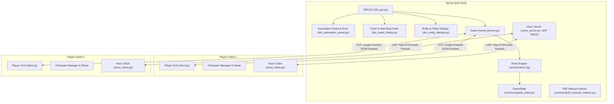

# D&D OmniCompanion — Operational Guide & System Manual

> 🌐 **Language / Lingua**: 🇬🇧 **[English (OPERATIONAL_GUIDE.md)](OPERATIONAL_GUIDE.md)** | 🇮🇹 **[Italiano (GUIDA_OPERATIVA.md)](GUIDA_OPERATIVA.md)**
> 📖 **Step-by-Step User Guide**: See also the **[Complete User Guide (USER_GUIDE.md)](USER_GUIDE.md)**.

Welcome to the comprehensive operational manual for **D&D OmniCompanion**, a complete Virtual Tabletop (VTT) and campaign companion engine built in Python for Dungeons & Dragons 5th Edition.

---

## Table of Contents
1. [Architecture & Network Model](#1-architecture--network-model)
2. [Prerequisites, Downloads & Quick Start](#2-prerequisites-downloads--quick-start)
3. [User Interface & Layout Overview](#3-user-interface--layout-overview)
4. [Dungeon Master (DM) Operations](#4-dungeon-master-dm-operations)
   - [Campaign Management Styles (DM Agency vs Full Automation) & Pending Actions Dock](#campaign-management-styles-dm-agency-vs-full-automation--pending-actions-dock)
   - [Map Management & Hex Grid](#map-management--hex-grid)
   - [Doors, Locks & RAW 5e Lockpicking](#doors-locks--raw-5e-lockpicking)
   - [Dungeon Room Pins & Boxed Text](#dungeon-room-pins--boxed-text)
   - [Blind Rolls to the DM (/broll, /gmroll)](#blind-rolls-to-the-dm-broll-gmroll)
   - [Fog of War, Dynamic Lighting & Line of Sight](#fog-of-war-dynamic-lighting--line-of-sight)
   - [Traps, Hazards & Portals (Teleports)](#traps-hazards--portals-teleports)
   - [Combat Management & Live Encounter Balancer](#combat-management--live-encounter-balancer)
   - [Monster Bestiary & Offline PDF Indexer](#monster-bestiary--offline-pdf-indexer)
   - [Handouts & Clue Sharing](#handouts--clue-sharing)
   - [Campaigns, Scenes, Shops & Quests](#campaigns-scenes-shops--quests)
   - [Party Management & Loot Splitting](#party-management--loot-splitting)
   - [Audio Soundboard](#audio-soundboard)
5. [Player Operations](#5-player-operations)
   - [Character Creation & Progression Wizard](#character-creation--progression-wizard)
   - [Interactive Character Sheet](#interactive-character-sheet)
   - [Magic Item Attunement (Attunement `🔮`) & DM Inspiration](#magic-item-attunement-attunement--dm-inspiration)
   - [Combat Actions & 5e Turn Flow](#combat-actions--5e-turn-flow)
   - [Death Saving Throws Automation](#death-saving-throws-automation)
   - [Inventory & Encumbrance Grid](#inventory--encumbrance-grid)
   - [Spellbook & Spell Slot Management](#spellbook--spell-slot-management)
   - [Peer-to-Peer Player Trading](#peer-to-peer-player-trading)
   - [Hotbar Quick Macros](#hotbar-quick-macros)
   - [Familiars, Beast Companions & Summoned Creatures (5e RAW)](#familiars-beast-companions--summoned-creatures-5e-raw)
   - [Travel System & Marching Order](#travel-system--marching-order)
6. [5e Mechanics & Automation Engine](#6-5e-mechanics--automation-engine)
   - [Advantage & Disadvantage Computation](#advantage--disadvantage-computation)
   - [RAW Reactions & Shield Spell Prompt](#raw-reactions--shield-spell-prompt)
   - [Special Traits: Evasion & Sneak Attack](#special-traits-evasion--sneak-attack)
   - [Dynamic Cover System](#dynamic-cover-system)
   - [Opportunity Attacks](#opportunity-attacks)
   - [Concentration Checks](#concentration-checks)
   - [Damage Absorption, Resistances & Rage](#damage-absorption-resistances--rage)
   - [Resting & Hit Dice](#resting--hit-dice)
7. [Communication & Voice Chat](#7-communication--voice-chat)
   - [Discord-Styled Rich Chat](#discord-styled-rich-chat)
   - [Private Whispers](#private-whispers)
   - [Integrated UDP Voice Chat](#integrated-udp-voice-chat)
8. [Chat Commands & Hotkeys Reference](#8-chat-commands--hotkeys-reference)
9. [Bilingual Internationalization (IT / EN) & Distance Units (ft / m)](#9-bilingual-internationalization-it--en--distance-units-ft--m)
10. [Testing Suite & Quality Assurance](#10-testing-suite--quality-assurance)

> 🇮🇹 **Guida in Italiano**: Consulta anche la **[Guida Completa all'Utilizzo (Italiano)](GUIDA_ALL_UTILIZZO.md)**.

---

## 1. Architecture & Network Model

D&D OmniCompanion is structured around an asynchronous Client-Server architecture combining reliable TCP state management with low-latency UDP voice streaming.



### Core Subsystems
* **`common/network_utils.py` & `common/protocol.py`**: Custom binary-length-prefixed framing over TCP socket streams, ensuring zero JSON chunk fragmentation regardless of network latency or payload size. The `protocol.py` module includes **strict static typing (`TypedDict`)** establishing unambiguous payload contracts across all client/server exchanges, **GM Layer Protocol Filtering** (the server automatically excludes tokens with `layer == "gm"` when broadcasting `GAME_STATE`, `PLAYER_JOINED`, and `PLAYER_MOVE` to regular player sockets), and dedicated message types for tactical whiteboard, blind rolls (`/broll`), door operations, and room narration.
* **`server/dm_automation_panel.py`, `dm_travel_dialog.py`, `dm_entity_dialogs.py`**: Specialized controllers extracted from `dm_gui.py`:
  * `dm_automation_panel.py`: manages the 3 campaign conduction profiles (`🎲 Traditional Tabletop`, `⚖️ Assisted Hybrid`, `⚡ Full Automation`), the 11 granular toggles, and the **Floating DM Pending Actions Dock**.
  * `dm_travel_dialog.py`: travel pace, overland marching order, ration/water tracking, and forced march constitution saving throws.
  * `dm_entity_dialogs.py`: token sizing (Tiny to Gargantuan), magical auras, and contextual token attributes.
* **`common/hex_utils.py`**: Mathematical engine for geometric grids:
  * Cubic coordinate system ($q, r, s$ where $q + r + s = 0$) with `HexLayout` for hexagonal maps, line of sight (LoS) raycasting, cone projections ($60^\circ / 90^\circ$), spheres, and straight-line AoEs.
  * `SquareLayout` for chess/square dungeon battlemaps and pixel $\leftrightarrow$ cell conversion.
  * Polymorphic `grid_distance(a, b, grid_type)` function supporting Chebyshev distance (standard 5e rule where diagonals cost 5 ft / 1 cell), cubic hex distance, and Euclidean distance for gridless maps (`none`/`gridless`).
* **`server/voice_server.py` & `client/voice_client.py`**: Real-time UDP audio broadcast and streaming. On Windows systems, the UDP socket is configured with `SIO_UDP_CONNRESET` to intercept ICMP Port Unreachable packets, ensuring client disconnects never crash the server's `recvfrom` loop.
* **`client/client.py`**: Main graphical client and async message loop protected by a `try...finally` block in `process_queue`, ensuring uninterrupted scheduling at regular intervals (`self.master.after(100, ...)`) regardless of unexpected packet contents.
* **`server/rules/`**: Decoupled 5e rule modules:
  * `combat.py`: initiative, attacks, auto-criticals within 5ft on Unconscious/Paralyzed creatures, cover and line of sight accounting for closed doors (`get_effective_map_walls`), bilingual damage resistances/vulnerabilities, reaction prompts (*Shield* spell, opportunity attacks) with turn-lock bypass (`is_reaction=True`), Evasion, and Sneak Attack.
  * `movement.py`: hex movement, anti-cheat validation (DM privilege verification with active network socket), condition and temporary HP preservation on traps, FoW, difficult terrain, and map teleports.
  * `character.py`: damage absorption, temporary HP, concentration constitution saves, 0 HP, instant death, death saving throws, and rests.
  * `chat.py`: rich chat, dice expressions, Nat20/Nat1 detection, private whispers, and blind rolls (`/broll`, `/gmroll`).
  * `map_interaction.py`: pings, ruler, interactive doors, lockpicking with tools, room pins, and boxed text broadcast.
  * `inventory.py` & `client/character_manager.py`: peer-to-peer trading, merchant shops, currency (50 coins = 1 lb), DM approval, magic item attunement (`🔮`), per-item storage containers (`🎒 Backpack`, `⚔️ Equipped`, `🔮 Bag of Holding`, `✨ Handy Haversack`, `🐴 Mount`), tactical "Drop Backpack" action (PHB p. 190), and 5e Variant: Encumbrance (PHB p. 176) with dynamic effective speed penalties.
  * `audio.py`: synchronized audio broadcasts and soundboard.
* **`components/statblock_view.py` (`StatblockCardView`)**: Modular UI component for authentic Dark Fantasy D&D 5e statblock rendering. Supports three polymorphic modes: **Monsters/NPCs** (AC/HP/Speed badges, 6-stat table with calculated modifiers, saving throws, skills, damage/condition resistances, traits, actions with highlighted dice formulas, reactions, legendary actions), **Magic Items** (rarity, item type, attunement, properties), and **Spells** (level, school, casting time, range, components, duration, and upcast scaling). Features contextual primary action buttons and responsive canvas scrolling.
* **`common/srd_offline.py`**: Offline compendium and data normalization layer. Provides `normalize_ac_value` and `normalize_speed_value` to sanitize incoming payloads from raw JSON nested dictionaries (`[{}]`), robust regex parsing for multi-movement modes (fly, swim, burrow, climb), numeric fractional CR conversion (`"1/8"`, `"1/4"`, `"1/2"`), and automated stat enrichment for entries extracted from offline PDF rulebooks.
* **`common/file_utils.py`**: Cross-platform filesystem path abstraction (`get_base_dir()`, `get_writable_dir()`, `ensure_writable_dir()`). Strictly decouples read-only bundled application assets (SRD dataset, core manuals, maps, campaigns) from user-writable persistent storage (`client_data`, settings, runtime indexed manuals), ensuring full compatibility both when running from source and inside compiled standalone bundles (PyInstaller).
* **`common/i18n.py`**: Real-time bilingual translation dictionary (`IT`/`EN`), Imperial/Metric unit conversion (`ft`/`mi` $\leftrightarrow$ `m`/`km`), localization of token sizes, GM layer, whiteboard tools, and multi-scale map distance/travel-time calculation.

---

## 2. Prerequisites, Downloads & Quick Start

### 📦 Download Pre-Built Standalone Executables (Windows & Linux)
To run D&D OmniCompanion without needing to install Python or configure virtual environments, standalone release packages can be downloaded directly from the official [GitHub Releases](https://github.com/Gaian-pixel/DndOmniCompanion/releases) page:
* **Windows (64-bit)**: Download `DndOmniCompanion-v*-win64.zip`, extract anywhere and launch `DndOmniCompanion.exe`.
* **Linux (x86_64)**: Download `DndOmniCompanion-v*-linux-x64.tar.gz`, extract (`tar -xzf ...`) and run `./run.sh` (or `./DndOmniCompanion`).

---

### 💻 Running from Source (Python)

#### System Requirements
* **Python 3.9+** (tested and verified up to Python 3.14).
* **Linux System Dependencies (Ubuntu/Debian)**:
  For Tkinter GUI rendering and audio/voice streaming:
  ```bash
  sudo apt-get update && sudo apt-get install -y python3-tk libportaudio2 libsndfile1
  ```
* **Install Python Dependencies**:
  ```bash
  pip install -r requirements.txt
  ```
  *(Note: `sounddevice` and `numpy` are utilized for real-time voice streaming. In headless environments, containerized servers or machines without physical audio hardware, the application automatically handles missing audio and respects `DND_MOCK_AUDIO=1`).*

#### Launching the Application
* **On Windows**:
  ```bash
  python main.py
  ```
* **On Linux**:
  ```bash
  chmod +x run_linux.sh
  ./run_linux.sh
  # or: python3 main.py
  ```

The **Unified Launcher** will prompt you to select a mode:
1. **Dungeon Master**: Launches the Host DM server on default ports `53911` (TCP) and `53912` (UDP) and opens the DM Dashboard (with Campaign, Campaign Editor, or Quick Session).
2. **Player**: Launches the Player VTT client, allowing character selection and connection to the DM server via IP/hostname.
3. **Offline Character Management & Creation Wizard**: Manage character sheets, export to Official PDF/JSON, or launch the BG3-style Level 1 character creation wizard completely offline.

---

### 🛠️ Multiplatform Build Script & CI/CD Release Pipeline

* **Local Build Script (`build_release.py`)**:
  Builds standalone distributions using PyInstaller into `dist/DndOmniCompanion`:
  - **On Windows**: bundles assets (`srd_data`, `manuals`, `campaigns`, `audio_library`, `maps`) and generates `DndOmniCompanion-v*-win64.zip`.
  - **On Linux**: generates the native ELF binary, sets `0755` execution permissions on `run.sh` and compiles `DndOmniCompanion-v*-linux-x64.tar.gz`.
* **GitHub Actions Automation (`.github/workflows/release.yml`)**:
  Triggered automatically on every `v*` tag push or manual workflow dispatch. Runs parallel runners on `windows-latest` and `ubuntu-latest`, compiles standalone binaries, and attaches both `.zip` and `.tar.gz` packages directly to the GitHub Release via `softprops/action-gh-release@v2`.
* **Read-Only vs. Writable Path Abstraction (`common/file_utils.py`)**:
  - `get_base_dir()`: locates immutable bundled distribution assets (source directory or PyInstaller `_internal` bundle).
  - `get_writable_dir()`: returns and ensures writable user directories (`client_data`, settings, databases, runtime manual cache), preventing permission errors when the application is installed in system directories.

---

## 3. User Interface & Layout Overview

Both the DM and Player interfaces are built with **ttkbootstrap** in modern dark fantasy styling, organized into a 3-column layout inspired by modern VTTs and Discord:

| Column | Component | Purpose |
|---|---|---|
| **Left Toolbar** | Compact Icon Strip | Context-sensitive map tools (`👆` Select/Center, `📏` Scale-Aware Ruler, `💥` Area of Effect, `📍` Ping, `📖` Rulebooks, `🚪` Teleport, `☁️` Fog of War) with tooltips. |
| **Center Viewport** | `HexMapCanvas` | Infinite zoom & pan interactive hex canvas with top-center **Initiative Ribbon HUD** during combat, bottom-left **Glassmorphism Zoom/Center HUD**, dynamic Fog of War, lighting halos, auras, tokens, condition badges, walls, and ruler vectors. |
| **Right Sidebar** | Tabbed Notebook | Tabs for Chat / Dice Log, Voice Controls, Hero Summary Card & Action Economy, Party & NPC Tracker, World & Calendar, Bestiary, and Audio/SFX. |

* **Quick Command Palette (`Ctrl+K`)**: Press `Ctrl+K` at any time to search 5e rules, monsters, spells, map tokens, or execute instant `/roll` commands.

### Single-Window Architecture (Mono-Finestra & Decoupled Frame Pattern)

D&D OmniCompanion implements a decoupled architectural pattern allowing UI components to be used interchangeably as in-place embedded frames or as standalone dialog windows (`Toplevel`):

1. **`*Frame` vs `*Dialog` Pattern**:
   * Core UI components inherit from `ttk.Frame` (or `tk.Frame`), accepting any generic `parent` container and separating presentation logic from top-level window management:
     * `CharacterManagerFrame` (in `client/character_manager_ui.py`) $\leftrightarrow$ `CharacterManagerDialog`
     * `CharacterCreationWizardFrame` (in `client/character_creation_wizard.py`) $\leftrightarrow$ `CharacterCreationWizardDialog`
     * `CharacterSheetFrame` (in `client/character_sheet_ui.py`) $\leftrightarrow$ `CharacterSheetDialog`
     * `CampaignEditorFrame` (in `server/campaign_editor_ui.py`) $\leftrightarrow$ `CampaignEditorDialog`
   * Corresponding `*Dialog` classes act as lightweight wrappers that construct a `tk.Toplevel`, instantiate their respective `*Frame`, and delegate calls, ensuring full backward compatibility.

2. **In-Place Launcher Navigation (`main.py`)**:
   * The unified launcher manages navigation within a single host window. When the user launches a tool (e.g. Character Manager or Campaign Editor), the initial role cards are hidden (`pack_forget()`) and the corresponding `*Frame` is packed directly in-place.
   * A persistent top navigation banner (`_build_banner()`) provides a `[ ← Back to Main Menu / Torna al Menu Principale ]` button to cleanly unmount the active frame and restore the role selector.

3. **Center Overlay & Dock/Detach Lifecycle in Player VTT (`client/client.py`)**:
   * **Center Overlay**: The Character Sheet mounts dynamically as a centered overlay (`_sheet_overlay_frame`) placed directly above the map viewport via `place()`, complete with a title bar featuring `[ ◱ Detach Window / Stacca Finestra ]` and `✖` buttons.
   * **Global Shortcuts**: Hotkeys **`C`** (toggle overlay / re-dock) and **`Esc`** (close overlay if open) are bound directly to the main toplevel window (`<c>`, `<C>`, `<Escape>`).
   * **Detaching (`detach_character_sheet()`)**: Destroys the in-canvas overlay frame, spawns a new `tk.Toplevel` (`_sheet_window`), embeds `CharacterSheetFrame` inside it, and attaches the `[ ◰ Dock to Map / Riaggancia alla Mappa ]` action button.
   * **Docking (`dock_character_sheet()`)**: Safely closes the detached window and recreates the centered overlay on the map canvas, guaranteeing seamless continuity of character data and state.

---

## 4. Dungeon Master (DM) Operations

### Campaign Management Styles (DM Agency vs Full Automation) & Pending Actions Dock
The server features a granular architecture for balancing 5e automation with human DM agency, encapsulated in `server/dm_automation_panel.py` and persisted in `GameState`:
* **Data Model**:
  * `GameState.automation_profile`: stores the active campaign profile (`"traditional"`, `"hybrid"`, `"full"`).
  * `GameState.automation_toggles`: dictionary of 11 independent boolean flags (`auto_attack_damage`, `auto_aoe_damage`, `auto_concentration`, `auto_advantage_disadvantage`, `auto_critical_damage`, `auto_traps`, `auto_turn_economy`, `auto_spell_slots`, `auto_encumbrance`, `auto_death_saves`, `auto_weather_effects`).
* **Operational Profiles**:
  * **`🎲 Traditional Tabletop`**: Keeps full control in the DM's hands. Attacks and spells compute math but do not modify HP without DM confirmation; doors and saving throws preserve room for narrative; no invisible walls block movement.
  * **`⚖️ Assisted Hybrid`**: Recommended for most gaming groups. Automatically resolves complex bookkeeping (cover, resistances, conditions, formulas) and forwards critical events to the floating pending actions dock.
  * **`⚡ Full Automation`**: Tactical CRPG mode. Damage is applied immediately, turns are strictly locked, reactions and traps trigger automatically.
* **Floating DM Pending Actions Dock**:
  * A non-intrusive floating dock located at the bottom-center of the DM's screen.
  * When an action requires DM adjudication, an interactive card pops up offering 1-click resolution buttons: `[ ✅ Apply ]`, `[ ✂️ Half ]`, `[ ✏️ Edit ]`, `[ ❌ Reject ]`.

### Map Management, Multi-Grid & Scale-Aware Ruler
* **Loading Maps**: Navigate to `File -> Load Map`. Supported formats: `.png`, `.jpg`, `.jpeg`, `.json`.
* **Multi-Grid Geometry Engine (Hex, Square, Gridless)**:
  * **Hexagonal Grid (`hex`)**: cubic coordinate math with flat-topped and pointy-topped layouts.
  * **Square Grid (`square`)**: matrix layout using official D&D 5e **Chebyshev distance** (diagonal steps cost a standard 5 ft / 1 cell).
  * **Gridless Mode (`none` / `gridless`)**: suppresses on-screen grid lines for pictorial artwork; tokens move freely calculating true Euclidean distance.
  * **Live Grid Switcher (`📐 Grid: ...`)**: top status bar button allowing the DM to switch the active map's grid type live during session.
* **Multi-Scale Map Engine (DMG p. 14)**:
  * **Combat Scale** (`hex_size=30` or `60`): $1\text{ hex} = 5\text{ ft}$ ($1.5\text{ m}$).
  * **Exploration / Province Scale** (`hex_size=35`): $1\text{ hex} = 1\text{ mi}$ ($1.5\text{ km}$, $\sim 20\text{ min}$ marching/hex).
  * **World / Kingdom Scale** (`hex_size=15`): $1\text{ hex} = 6\text{ mi}$ ($9\text{ km}$, $2\text{ hours}$ marching/hex; $4\text{ hexes} = 1\text{ day}$).
  * **Custom Scale**: Any custom distance value and unit (`ft`, `m`, `mi`, `km`) per hex.
  * **Quick Scale Switcher (`📏 Scale`)**: Click the scale pill in the DM top bar to switch the active map's scale on the fly and broadcast it live to all connected players.
* **Map Editor**: Choose `Tools -> Map Editor` to configure grid radius, grid geometry type (`grid_type`), offset, scale, static walls, traps, portals, and lights.

### Doors, Locks & RAW 5e Lockpicking
* **Door States**: `open` (clear passage and sight), `closed` (blocks vision and movement), `locked` (requires key or lockpicking check with DC), `secret` (concealed from players), `barred` (braced from within).
* **RAW Lockpicking (PHB p. 154)**:
  * Requires *Thieves' Tools* in the PC inventory.
  * Dexterity check adding proficiency bonus against the lock's DC.
  * Supports brute-force attempts via Strength (Athletics) checks and magical bypassing via the *Knock* spell.
* **Automation Profile Integration**: In *Traditional Tabletop* mode, lockpicking attempts generate a pending decision card, allowing the DM to narrate complications or assess environmental consequences.

### Dungeon Room Pins & Boxed Text
* **Interactive Pins (`[ 📌 ]`)**: The DM can drop labeled pins directly on map locations linked to adventure sections.
* **Boxed Narration Text**: Formatted descriptive text that the DM can read aloud or broadcast instantly (**`📢 Read to Table`**) to all connected players as a chat handout.
* **Secret DM Notes**: Dedicated notes field for concealed traps, enemy tactics, hidden loot, and DC thresholds, visible exclusively to the DM.

### Blind Rolls to the DM (`/broll`, `/gmroll`)
* **Chat Commands**: `/broll <formula> [reason]` or `/gmroll <formula> [reason]`.
* **Anti-Metagame Security**: The server evaluates rolls via `common/dice.py`. The die roll, modifiers, and total are transmitted strictly to the DM's socket (`BLIND_ROLL_DM_NOTIFY`). The rolling player receives an acknowledgment toast without seeing the rolled number, preserving genuine mystery.

### Fog of War, Manual Brush, Dynamic Lighting & Line of Sight
* **Dynamic Fog of War (FoW)**: The canvas automatically conceals unexplored cells for players.
* **Manual FoW Brush (`Radius: 0, 1, 2, 3`)**: In the FoW control bar (`[ ☁️ ]`), the DM can select a brush radius and left-click (reveal) or right-click (hide) to paint or restore fog across contiguous circular areas.
* **Shared Party Vision**: As any party token moves, cells within its vision radius are revealed.
* **Dynamic Lighting**: Tokens carrying light sources (e.g., Torches: 20 ft bright / 20 ft dim; Lanterns: 30 ft bright / 30 ft dim) illuminate dynamically in real time.
* **Darkness Filter (`[ 🌑 ]`) & Magical Darkness**:
  * 1-Click toolbar toggle (`[ 🌑 ]`) or `/darkness` / `/oscurita` chat command: immerses the entire map in total pitch-black darkness (`#000000`).
  * Dynamic visibility rules: cells not lit by active torches/lanterns or uncovered by Darkvision appear pitch black.
  * Magical Darkness Spheres: placeable via right-click $\rightarrow$ `🌑 Piazza Sfera di Oscurità Magica (R=3)`. Non-magical Darkvision cannot see through magical darkness (PHB p. 194-195).
* **True Line of Sight (LoS)**: Geometric raycasting evaluates line-of-sight against walls (`wall_hexes`). Tokens behind impenetrable walls cannot be seen through FoW.

### Creature Token Sizes & DM Hidden Layer (GM Layer)
* **Official 5e Creature Token Sizes**: Full support for the 6 standard categories (**Tiny**, **Small**, **Medium**, **Large**, **Huge**, **Gargantuan**), with visual canvas radius scaling from $0.5\times$ to $3.5\times$. Configurable via right-click $\rightarrow$ `Creature Size`.
* **DM Hidden Layer (GM Layer)**:
  * Conceals monster or trap tokens from player clients.
  * DM Rendering: token renders semi-transparently with a dashed purple ring and a `[GM]` badge.
  * Network Security Filter: at the TCP protocol layer (`network_utils.py` and `game_state.py`), `GAME_STATE`, `PLAYER_JOINED`, and `PLAYER_MOVE` packets systematically filter out `layer == "gm"` tokens for non-DM sockets, eliminating metagame data leaks.
  * Toggle via right-click on token $\rightarrow$ `👁️ GM Layer`.

### Traps, Difficult Terrain, Hazards & Portals (Teleports)
* **Traps**: When a token enters a trap hex, the server:
  1. Checks Passive Perception against the trap's Detection DC.
  2. If triggered, rolls damage and prompts the player for a Dexterity Saving Throw.
  3. Reveals the trap visually on the map with an alert in chat.
* **Difficult Terrain & Hazardous Surfaces**:
  * 5 distinct terrain types with unique textures and color schemes: **Mud** (`mud`), **Slippery Ice** (`ice`), **Briars** (`briars`), **Rubble** (`rubble`), **Deep Swamp** (`swamp`).
  * **Movement Penalties**: Pathfinding (`hex_linedraw`) applies double movement cost ($\times 2$, stacks with the `Prono` / Prone condition).
  * **Entry Hazards**: Stepping onto Ice requires a DC 10 Dexterity saving throw or fall Prone; stepping into Briars deals $1d4$ piercing damage automatically with an alert in chat.
  * **On-the-Fly Painting & DM Tools**: DM can apply terrain via right-click on hex $\rightarrow$ `🌾 Terreno Difficile...` or using the `[ 🪨 ]` brush popup on the left toolbar (radius 0, 1, 2 with terrain type selector).
* **Portals & Teleports**: Clicking `[ 🚪 ]` on the DM toolbar allows binding an hex coordinate (e.g., `5,5`) to a destination map file (e.g., `dungeon_level2.json`). When a token steps on the hex, the server automatically transitions the party to the new map.

### Combat Management & Live Encounter Balancer
1. **Starting Combat**: Select targets or click **Inizia Combattimento** (Start Combat) in the `Iniziativa & PG` tab.
2. **Mass NPC Initiative**: The DM can click **Tira Iniziativa Mostri** to instantly roll initiative for all monsters in the encounter simultaneously with Dexterity modifiers applied.
3. **Turn Cycling**: Use **Prossimo Turno** (Next Turn) or **Precedente** to advance the initiative order. The active token is highlighted with a gold ring on the map, and a non-blocking toast notification announces their turn.
4. **Timed Effects Tracker & Save-Ends Mechanics (5e RAW)**:
   * **Official 5e Presets**: Accessible via the token context menu $\rightarrow$ *Modify Conditions*, supporting round-based durations (*Bless*, *Rage*, *Shield*, *Haste*, *Invisibility*...) and Save-Ends effects (*Hold Person*, *Bane*, *Blindness*, *Tasha's Laughter*, *Slow*, *Fear*, *Poisoned*).
   * **Automatic End-of-Turn Resolution**: When a creature finishes its turn (`End Turn` or DM advance), the combat engine queries all Save-Ends effects. Connected players receive an interactive prompt modal (`make_prompt_save`) with their character's effective saving throw bonus; for NPCs/monsters the server auto-rolls using sheet stats. Passing the DC immediately ends the effect and removes the linked condition with a chat notification.
   * **HUD & Token Badges**: Compact pill badges displaying remaining rounds or DC (*✨8r*, *🧊CD14*, *🛡️1r*) are rendered in real time both on the top Initiative Ribbon HUD cards and on map tokens.
   * **Global Concentration Break Link**: If a caster takes damage and fails their concentration check (or drops it), all linked effects maintained on any allies or enemies on the map dissolve immediately.
5. **Live Encounter Difficulty Calculator (DMG p. 82)**:
   * The DM panel dynamically tallies total player levels and monster challenge ratings (CR).
   * Calculates adjusted encounter XP using 5e monster count multipliers (from $1.5\times$ to $4\times$).
   * Displays real-time difficulty: **Banale (Trivial)**, **Facile (Easy)**, **Medio (Medium)**, **Difficile (Hard)**, or **Mortale (Deadly)**.
6. **Boss Mechanics & Legendary Actions**:
   * **Legendary Resistances**: Monsters with legendary resistance (e.g., 3/day) can turn a failed saving throw into a success with 1 click.
   * **Legendary Actions**: Spend legendary action points outside the boss's turn, resetting automatically at the start of each round.

### Monster Bestiary, Split View Compendium & Offline PDF Indexer
* **Compendium & SRD Split View (`server/compendium_ui.py`)**:
  * **Master-Detail Architecture**: Split-pane interface built with a dual-column layout. The left column houses the live search bar, fast-filtering controls (CR tiers, creature types, magic item rarity), and `ttk.Treeview`/`tk.Listbox` with an active counter. The right column mounts the `StatblockCardView` instance backed by smooth canvas scrolling.
  * **Integrated 5e Statblock Rendering**: Faithfully renders numeric and textual attributes fetched from APIs or parsed from PDF caches with high-contrast Dark Fantasy typography and styling.
  * **Spawning & Network Integration**: The primary action button triggers `on_monster_spawned` in `DM_GUI`, instantiating the creature as an NPC `Player` (`is_party_member=False`) placed at the targeted hex or viewport center, immediately broadcasting `PLAYER_JOINED` and `PLAYER_STATS_UPDATE` to all connected clients.
* **DM Bestiary Sidebar Panel (`server/dm_bestiary_panel.py`)**:
  * Integrated directly into the DM's right notebook. Features quick-filtering pills for Challenge Rating (*All, 0-1/2, 1-4, 5-9, 10-14, 15-19, 20+*) and Creature Types (*Dragon, Undead, Humanoid...*).
  * **Responsive Mini-Statblock**: Instantly displays a structured card summary with AC/HP/Speed badges and compact ability scores, preserving full backward compatibility with `self.bestiario_preview`.
  * **Instant Spawning**: Double-click any monster in the list to spawn it on the map without opening separate dialogs.
* **Data Normalization Pipeline (`common/srd_offline.py`)**:
  * `normalize_ac_value`: Sanitizes heterogeneous incoming AC data (raw integers, dicts with `'value'`/`'type'`, unparsed JSON lists) into clean, rulebook-compliant descriptive strings (e.g. `18 (plate armor)`).
  * `normalize_speed_value`: Parses multi-movement dictionaries (`"walk"`, `"fly"`, `"swim"`, `"burrow"`, `"climb"`) into readable strings for both sheet viewing and map movement.
* **Offline PDF Indexer (`common/pdf_manuals_indexer.py`)**: Searches offline directly inside official rulebook PDFs (Monster Manual, Player's Handbook, Dungeon Master's Guide) cached in `manuals/pdf_index_cache.json`.

### Handouts & Clue Sharing
* Open `Strumenti -> Condividi Documento (Handout)`.
* Enter a title and text (e.g., ancient letter, cipher, map fragment).
* Broadcasts immediately to all connected clients, popping up an authentic dark fantasy parchment modal dialog.

### Campaigns, Scenes, Shops & Quests
* **Campaign & Scene Manager**: Prepare encounters in advance as "Scenes" linked to specific maps and tokens. Switch scenes seamlessly during live play without manual re-placement.
* **Shop & Economy System**: Open merchant stores where players can browse goods, check inventory weight, and purchase gear deducted directly from their gold pieces.
* **Quest Log**: Track Active, Completed, and Failed quests with milestone rewards.

### Party Management & Loot Splitting
* **Party vs NPC Separation**: In out-of-combat mode, the DM listbox separates players into `--- PARTY ---` and `--- NPC ---`. Right-click any entity to toggle party status.
* **Loot Splitter**: Click **Dividi Denaro** and enter an amount of Gold Pieces (GP). The server divides the gold evenly among all active party members and updates their character sheets automatically.

### Audio Soundboard
* The `Audio/Sfx` tab provides instant atmospheric soundscape broadcast buttons (e.g., Tavern, Battle, Dungeon Ambience) played synchronously on client browsers/media players.

### Shared Tactical Whiteboard & Session Log Export
* **Tactical Whiteboard (`[ ✏️ ]` / `[ 🗑️ ]`)**: real-time freehand sketching broadcast live to all clients. Instant clear button with TCP broadcast.
* **Session Log Export (`File -> 📜 Export Session Log...`)**: export the entire session transcript (dice rolls, combat events, chat, whispers) into formatted Markdown (`.md`) or HTML.

---

## 5. Player Operations

### Character Creation & Progression Wizard
* Accessible via `Libreria -> Creazione Personaggio` or the Level-Up button.
* **Baldur's Gate Styled UI in 5 Guided Steps**:
  * **Step 1: Race**: Selection of the 9 core 5e races with ability matrix, lifespan, senses, resistances, and synergies. Includes the **Master-Detail Advanced Races Compendium (`[ 📊 Tabella Comparativa ]`)** with live search, 1-click category pills (`[Tutte]`, `[🛡️ Resistenze]`, `[👁️ Scurovisione]`, `[🏃 Taglia Piccola]`, `[⚔️ Mischia]`, `[✨ Magiche]`), 6-column master table with bidirectional scrolling, reactive preview card on the right (lore, defenses, class synergies, detailed traits, and subraces), and double-click selection.
  * **Step 2: Class**: Selection of the 12 core 5e classes with Hit Die ($1\text{d6}$–$1\text{d12}$), Primary Abilities, Saving Throws, Party Role, Complexity, Quick Build recommendations, and starter gear preview. Includes the **Classes Comparison Compendium** with category filters (`[All]`, `[Martial]`, `[Spellcaster]`, `[Hybrid]`, `[Expert]`).
  * **Step 3: Ability Scores**: Standard Array, Point Buy (27 points), or Dice Roll (4d6 drop lowest) with automatic racial bonus computation.
  * **Step 4: Background**: Origin proficiencies, bonus languages, and background gear.
  * **Step 5: Details, Portrait & Token**: Character name, deity, notes, and avatar portrait upload.
* **Character Avatar & Automatic Map Token**:
  * Uploaded character portraits (as well as NPC and monster art uploaded by the DM) automatically become the **Tactical Token rendered on the Map Canvas**, featuring antialiased circular framing, faction/class border coloring, condition badges, and dynamic size scaling (Tiny $0.5\times$ to Gargantuan $3.5\times$).
* **Level-Up Wizard**:
  * Calculates HP gain (Hit Die roll or fixed average).
  * Automatically fetches class features from the 5e SRD for the new level and populates both `features` and `features_list` with immediate model synchronization to prevent any class trait loss upon saving the sheet.
  * Handles Ability Score Improvements (ASI) or Feats, enforcing the **20 ability score maximum cap** and disallowing duplicate attribute selection in +1/+1 mode.
  * Dynamically recalculates the proficiency bonus ($2 + \lfloor(\text{Level}-1)/4\rfloor$) and updates saving throws, skill checks, and weapon attack bonuses.
  * Unlocks updated spell slot progression tables, including dedicated support for **Artificer** (2 slots at 1st level) and **Third-Casters** (*Eldritch Knight* and *Arcane Trickster* starting at 3rd level).

### Interactive Character Sheet
Organized in clean tabs:
* **Combat Tab**: Current/Max HP, Temp HP, Armor Class, Speed, Initiative bonus, Active Conditions with visual status badges, Death Saves, Hit Dice tracker.
* **Stats & Skills Tab**: Six core ability scores, saving throw proficiencies, passive perception, and all 18 skill proficiencies with automatic modifier computation.
* **Inventory Tab**: Grid-based inventory with item weights, quantity, attuned items, and total weight vs carrying capacity ($\text{STR} \times 15\text{ lbs}$).
* **Spellbook Tab**: Level 1 to 9 spell slots with current/max counters, spell search, modal **Spell Upcasting**, and 1-click casting with automatic slot deduction.
* **Features & Traits**: Racial traits, class privileges, **Special Class Resources** tracker, feats, and custom notes.

### Special Class Resources System
* **Class Automation**: When creating a character or leveling up, standard 5e class resources are automatically populated (e.g., *Ki Points*, *Rage*, *Bardic Inspiration*, *Wild Shape*, *Channel Divinity*, *Action Surge*, *Second Wind*, *Sorcery Points*, *Lay on Hands*).
* **Interactive Adjusters**: Quick `[-]` / `[+]` counter buttons to expend or replenish charges live during play.
* **Custom Resources**: Add custom resource pools with Name, Max Value, and Recovery Rule (*Short Rest* vs *Long Rest*).
* **Automated Rest Recovery**: Triggering a Short Rest or Long Rest automatically resets only the resources configured for that rest duration.

### Magic Item Attunement (Attunement `🔮`) & DM Inspiration
* **Attunement Tracking (DMG p. 136)**:
  * Strict enforcement of the official maximum of **3 simultaneously attuned magic items** per character.
  * Attuned items apply passive stat modifiers (AC, saving throws, attack bonuses) automatically to sheet values.
  * Attempting to attune a 4th item prompts the player to first end an active attunement during a short rest.
* **DM Inspiration**:
  * Persistent visual badge in the sheet header and hero summary card (`✨`).
  * The DM can grant or revoke inspiration with 1 click.
  * The player can spend inspiration before rolling to apply Advantage (`2d20kh1`) automatically.

### Combat Actions & Context-Aware 5e Turn Economy
The Player Action Economy panel automatically adapts to whether combat is active:
* **Out of Combat (`🧭 Exploration Mode - Free Movement`)**:
  * Action badges (`⚡ Action`, `✨ Bonus`, `🛡️ Reaction`) remain in `Free (Exploration)` mode and are never locked when moving, attacking, or casting spells outside combat.
  * The movement bar displays the character's per-move speed (`👟 Speed: 30 ft / 9 m (Free)`).
* **During Combat (`Turn Economy`)**:
  1. **Turn Notification**: Visual banner, **Initiative Ribbon HUD** arrow `▼`, and toast appear ("È IL TUO TURNO!"). All turn economy resources reset automatically via `TURN_ECONOMY_UPDATE`.
  2. **Move**: Click on the destination hex (movement path is validated against remaining speed; Prone condition doubles movement cost).
  3. **Action Menu**: Click `Azione` to choose standard 5e actions:
     * **Attacco (Attack)**: Select weapon, pick target on map with 1 click (consumes `⚡ Action`).
     * **Lancia Incantesimo (Cast Spell / AoE)**: Open AoE tool, select template (Sphere, Cone, Line), choose radius/length, and place on hex grid.
     * **Scatto (Dash)**: Doubles current speed for the turn (consumes `⚡ Action`).
     * **Disimpegno (Disengage)**: Prevents triggering opportunity attacks during movement.
     * **Schivata (Dodge)**: Gives attackers disadvantage until the start of your next turn.
     * **Aiuto (Help)**: Gives an ally advantage on their next attack roll against a nearby enemy.
  4. **End Turn**: Click `Termina Turno` to pass initiative to the next combatant.

### Death Saving Throws Automation
* If you start your turn at **0 HP**:
  * A Death Save prompt opens automatically. You can also roll with `/tsmorte`, `/deathsave`, or `/ds`.
  * **Natural 20**: Regain 1 HP immediately, stand up, and clear the `Incosciente` (Unconscious) condition.
  * **Roll $\ge 10$**: +1 Success (at 3 successes, you gain the `Stabilizzato` condition).
  * **Roll $< 10$**: +1 Failure.
  * **Natural 1**: Counts as **2 Failures** (at 3 failures, you gain the `Morto` condition).
* **Taking Damage at 0 HP**: Taking damage while at 0 HP automatically marks **1 death save failure** (or **2 failures** if the damage is from a Critical Hit).
  * **Permanent Death & Lootable Corpse**: Upon accumulating 3 failures, the character gains permanent `💀 Dead` status; the server automatically spawns an interactive corpse token on the map canvas containing all carried inventory.
  * **Healing at 0 HP**: Receiving healing while at 0 HP restores health, **completely resets all death save successes and failures back to 0**, and immediately clears the `Unconscious` and `Stabilized` conditions.
  * **Instant Death**: Excess damage equaling or exceeding Max HP triggers immediate instant death.

### Inventory, Encumbrance & DM Approval (Online & Offline)
* **Anti-Cheat DM Approval Rules (Online & Offline)**:
  * **Restricted Self-Addition/Removal from SRD**: Players cannot arbitrarily add items or spells to their inventory or spellbook from the SRD compendium, nor remove them at will without DM authorization.
  * This architectural rule strictly operates **both during live multiplayer sessions and offline during character management**, safeguarding sheet integrity. Any attempted addition or removal routes a formal approval request to the DM (`ITEM_APPROVAL_REQUEST` / `SPELL_APPROVAL_REQUEST`).
* **Currency Synchronization & True Inventory Weight**:
  * **Bidirectional Synchronization**: Held coins (`CP`, `SP`, `EP`, `GP`, `PP`) are synchronized in real time between the inventory item list and the top currency table.
  * **Dynamic Weight Computation**: Total inventory weight accurately reflects all carried physical items, ammunition, weapons, armor, and RAW coin weight ($50\text{ coins} = 1\text{ lb}$).
* **Container Management & Extradimensional Storage**:
  * Instant location assignment to `🎒 Backpack`, `⚔️ Equipped`, `🔮 Bag of Holding`, `✨ Handy Haversack`, or `🐴 Mount`. Gear inside extradimensional storage (up to 500 lbs) does not count against carried encumbrance.
* **Spendable Consumables & Healing Potions (`[-1]` / `[+1]`)**:
  * Inline counter buttons on consumable inventory rows (arrows, bolts, rations, torches, potions) to spend or restore a single unit with 1 click. Consuming healing potions or curatives instantly updates both the numerical HP and health bar on the sheet, synchronizing stats with the game server.
* **Safe Peer-to-Peer Trading (Anti-Duplication)**:
  * Direct item or gold transfers between players clear the inventory slot in the sender's sheet prior to packet transmission, eliminating any item duplication vulnerability across asynchronous network calls.
* **Markdown Journal & Notes with DM Validation**:
  * Campaign journal and personal notes feature full visual Markdown rendering (`**bold**`, `*italics*`, bullet lists, headers). Modifications require Master validation to preserve campaign chronicle integrity.

### Spellbook, Slot Management & Spell Upcasting
* Add spells using the built-in SRD browser.
* **Automatic Upcasting**: Clicking **Cast** on a 1st+ level spell opens a modal selector displaying all available slots up to 9th level. Choosing a higher-level slot consumes that slot and broadcasts the cast announcement with both base and upcast levels.
* **Long Rest** restores all spell slots to maximum.

### Character Sheet Export (Official PDF & JSON)
* Click **`📥 Esporta Scheda...`** at the bottom of the character sheet:
  * **Official PDF**: Prompts you to select your blank PDF template (e.g., `dnd_blankcharactersheet_it.pdf`) and compiles the official 3-page sheet with complete stats, skill proficiency dots, hit dice, weapons, currency, inventory, notes, and full spellbook. Ready for printing and archival.
  * **JSON**: Raw structured data for backup, editing, and campaign migration.

### Peer-to-Peer Player Trading
* Open player trade via the context menu or inventory tab.
* Select items and gold to offer to an ally.

### Hotbar Quick Macros
* 10 customizable quick slots at the bottom of the player panel.
* **Right-Click Slot**: Configure macro command (e.g., `/roll 1d20+5 Spada Lunga`, `/ds`, `/tsmorte`).
* **Left-Click Slot**: Instantly executes the macro in chat.

### Familiars, Beast Companions & Summoned Creatures (5e RAW)
Accessible directly via the `🐾` button on the VTT **Hero Summary Card** for all players:
* **Familiars (Find Familiar - PHB p. 240 & Pact of the Chain)**:
  * **Forms Catalog**: Standard animal forms (*Owl* with Flyby and 120 ft Darkvision, *Bat* with 60 ft Blindsight, *Cat*, *Hawk*, *Raven*, *Poisonous Snake*, *Toad*, *Spider*) and Warlock Chain Pact forms (*Imp*, *Pseudodragon*).
  * **5e RAW Non-Attack Enforcement**: Standard familiars **cannot make attacks** (attack requests are strictly validated and blocked at the server engine); they may instead take Help, Dodge, Dash actions or deliver spells. Pact of the Chain familiars are permitted to make attacks.
  * **Pocket Dimension**: Masters can dismiss familiars into an extradimensional space (hiding the token from all players) and recall them at any time to appear within 30 ft (6 hexes).
  * **Touch Spell Delivery**: Masters can cast touch spells (*Shocking Grasp*, *Cure Wounds*, etc.) through their familiar; if the familiar is within 100 ft (20 hexes) of the master and the target is within touch reach (1 hex) of the familiar, the familiar expends its **Reaction** to deliver the spell.
  * **Shared Senses**: Switch visual and auditory perception through the familiar's senses up to 100 ft.
* **Ranger Beast Companions (Beast Master / Tasha's Primal Companion)**:
  * **Beast Catalog**: *Wolf* (Pack Tactics and DC 11 Strength save to knock Prone), *Panther* (Pounce with bonus action attack), *Boar* (Relentless survival at 0 HP), *Giant Poisonous Snake* (10 ft reach and high poison damage), *Mastiff* (mount for Small characters).
  * **Automatic 5e RAW Stat Scaling**:
    * **Armor Class (AC)**: Base AC + Ranger's Proficiency Bonus (PB).
    * **Max Hit Points**: $\max(\text{Base HP}, 4 \times \text{Ranger Level})$.
    * **Attack & Damage Rolls**: Scaled upward with the Ranger's PB.
* **Summoned Creatures (Conjuration & Necromancy)**:
  * *Skeleton*, *Zombie*, *Conjured Wolf*, *Fey Spirit*.
  * **Concentration Linkage**: Concentration-dependent summons immediately dissolve and vanish from the map whenever the caster's concentration is broken or drops to 0 HP.
  * **No Corpse/Loot Spawning**: Upon dropping to 0 HP, familiars and summons vanish in a puff of spirit or mystical mist, leaving behind no corpses or map loot chests.

### Travel System, Hex-Crawl, Camp & Biome Encounters (5e RAW)
* **5e Travel Paces & Distances (PHB p. 182)**:
  * **Slow**: $2\text{ mph}$ ($18\text{ miles/day}$), $+5$ bonus to Passive Perception; allows the group or scout to move **Stealthily**.
  * **Normal**: $3\text{ mph}$ ($24\text{ miles/day}$).
  * **Fast**: $4\text{ mph}$ ($30\text{ miles/day}$), $-5$ penalty to Passive Perception; foraging/hunting disabled; $-5$ to Navigator Survival checks.
* **Biomes & Hex-Crawl Navigation**:
  * 8 integrated biomes: *Forest*, *Plains/Roads*, *Swamp*, *Mountain*, *Desert*, *Underdark*, *Coast*, *Tundra*.
  * Navigator Wisdom (Survival) checks vs terrain DC (from DC 10 for Plains to DC 20 for Desert and Underdark) to prevent party disorientation.
  * Foraging & Hunting (DC 15/20) yielding rations scaled by Wisdom modifier.
  * Forced March: marching beyond 8 hours daily forces progressive Constitution saving throws on all party members ($\text{DC} = 10 + \text{hours past 8}$); failure inflicts 1 level of Exhaustion.
* **Biome Random Encounter Generator & Danger Rating**:
  * 4 Danger Tiers: *Low / Safe* (d20 encounter threshold $\ge 18$), *Moderate / Wilderness* ($\ge 15$), *High / Dangerous* ($\ge 12$), *Extreme / Deadly* ($\ge 9$).
  * Authentic 5e encounter categories:
    * **Combat Threats**: Monsters with calculated quantities, Challenge Ratings (CR), Stealth DCs, and initial spawn distance. DMs can instantly spawn enemies onto the map canvas with 1 click (`on_monster_spawned`).
    * **Social Encounters**: Merchant caravans, hermits, local guides, pilgrims, and patrols with rumors and trade.
    * **Discoveries & Landmarks**: Ancient shrines, mineral healing springs, secure shelters, abandoned caches, and shipwrecks with loot.
    * **Environmental Hazards**: Rockslides, quicksand, toxic miasmas, ruined bridges, and dust storms with associated 5e saving throws.
* **Night Watch Shifts & Campsite Management**:
  * 8-hour Long Rest divided into 4 two-hour shifts (*Early Night*, *Midnight*, *Heart of the Night*, *Dawn*).
  * Strict 5e RAW compliance: sleeping characters may only stand watch for up to 2 hours (1 shift); **Elf Trance** requires only 4 hours of meditation, allowing up to 4 hours of watch (2 shifts).
  * Real-time calculation of **Effective Passive Perception** in darkness: disadvantage penalty ($-5\text{ PP}$) without Darkvision or an active campfire.
  * Nocturnal Resolution: when hostile threats emerge on a shift, active sentinels check their Passive Perception against the threat's Stealth DC. Alerted sentinels wake the party with no surprise; undetected threats trigger a **Night Ambush** (party assaulted in their sleep with *Unconscious* and *Prone* conditions). Peaceful nights restore full HP, refresh spell slots, and heal 1 level of Exhaustion.

---

## 6. 5e Mechanics & Automation Engine

### Critical Successes (Natural 20) & Critical Failures (Natural 1)
The dice engine (`roll_dice_detailed`) inspects all `d20` rolls (including Advantage `2d20kh1` and Disadvantage `2d20kl1`):
* **Attack Rolls**:
  * **Natural 20 (`🌟 CRITICO NATURALE 20!`)**: Automatic hit regardless of target AC, automatically doubling all damage dice while adding flat modifiers once.
  * **Natural 1 (`💀 FALLIMENTO CRITICO!`)**: Automatic miss regardless of attack bonus.
  * **Auto-Critical Hits on Incapacitated / Paralyzed Targets (PHB p. 291-292)**: Any attack roll that hits a creature with the *Unconscious* or *Paralyzed* condition within 5 feet (1 cell) automatically scores a Critical Hit with doubled damage dice.
* **Saving Throws, Skill Checks & Generic `1d20` Rolls**:
  * Highlights `🌟 20 NATURALE!` (gold) and `💀 1 NATURALE!` (crimson) in the chat log and dispatches a `CRITICAL_ROLL_BROADCAST` toast notification to all connected clients.

### Advantage & Disadvantage Computation
The combat engine calculates advantage and disadvantage dynamically based on token states, environmental hazards, and lighting:
* **Attacker gains Advantage if**:
  * Attacker is `Invisibile`.
  * Target is `Trattenuto`, `Paralizzato`, `Incosciente`, `Accecato`, or `Pietrificato`.
  * Target is `Prono` AND attack is melee (distance $\le 1$ hex).
  * Target is trapped in hazardous or restrictive terrain (**Briars** or **Deep Mud**).
  * Attacker is concealed in darkness and can see the target (via **Darkvision** or target carrying an **active light source** such as a Torch/Lantern), while target cannot see attacker.
* **Attacker suffers Disadvantage if**:
  * Attacker is `Accecato`, `Avvelenato`, `Trattenuto`, or `Prono`.
  * Target is `Prono` AND attack is ranged (distance $> 1$ hex).
  * Target is `Invisibile`.
  * Target took the `Schivata` (Dodge) action.
  * Attacker is standing on an unstable or slippery surface (**Ice**, **Swamp**, **Rubble**).
  * **Pitch-Black Darkness**: Attacker cannot see the target in darkness.
  * **Dynamic Weather Modifiers**:
    * **Storm** or **Dense Fog**: Disadvantage on all ranged attacks beyond 1 hex due to heavy rain, howling winds, and zero visibility.
    * **Heavy Rain**: Disadvantage on long-range attacks at distance $\ge 4$ hexes.
    * **Blizzard / Snow**: Disadvantage on long-range attacks at distance $\ge 3$ hexes.
* **Magical Darkness**: Standard Darkvision cannot penetrate magical darkness; anyone inside or attacking into magical darkness is blinded (PHB p. 194-195).
* **Mutual Cancellation**: Having both advantage and disadvantage (including mutual blindness in pitch-black darkness between creatures without darkvision) cancels out to a normal roll as per 5e rules, with full transparent reasoning recorded in the combat log.

### RAW Reactions & Shield Spell Prompt
* **Reaction Resource Management (PHB p. 190)**: Centralized tracking of each combatant's reaction pool, refreshing at the beginning of their respective turns.
* **Shield Spell Trigger**:
  * Trigger: An incoming attack roll equals or beats the target's AC, or the target is struck by *Magic Missile*.
  * The target's client receives an interactive reaction dialog with a prompt.
  * Upon acceptance: consumes the creature's reaction, expends a 1st+ level spell slot, and retroactively applies $+5$ to AC. If the revised AC exceeds the attack roll, the attack is re-evaluated as a miss before damage calculation.

### Special Traits: Evasion & Sneak Attack
* **Evasion (Rogue lv 7+ / Monk lv 7+)**:
  * On Dexterity-save based area of effect spells (e.g., *Fireball*), `server/rules/combat.py` applies automated damage scaling: successful save = 0 damage; failed save = half damage.
* **Sneak Attack (Rogue)**:
  * Automatic validation of 5e RAW conditions (finesse or ranged weapon, advantage on attack OR conscious adjacent ally within 1 hex without disadvantage, 1/turn limit).
  * Automatically rolls level-scaled bonus damage dice ($1d6$ to $10d6$) and integrates them into the damage payload.

### Tactical 5e RAW Cover System (PHB p. 196)
The combat engine supports both automated raycast cover calculation and explicit manual overrides selected by players or the DM:
* **Automatic Cover**: Traces the hex ray (`hex_linedraw`) between attacker and target to detect walls, closed or locked doors (`get_effective_map_walls`), half-cover obstacles, and living creatures (excluding corpses and GM-layer tokens). Closed doors completely block line of sight for ranged attacks.
* **Half Cover (`half`)**: $+2$ bonus to target AC and $+2$ to Dexterity saving throws.
* **Three-Quarters Cover (`three_quarters`)**: $+5$ bonus to target AC and $+5$ to Dexterity saving throws.
* **Total Cover (`total`)**: Target cannot be targeted directly; attacks are completely blocked.

### Strict Concentration & Spell Upcasting (PHB p. 201-204)
* **Single Concentration Enforcement**: The Spellbook automatically detects if a newly cast spell requires concentration. If the character is already concentrating, the existing concentration is automatically broken and announced in chat, preventing illegal simultaneous concentrations.
* **Damage Concentration Saves**: Taking damage while concentrating automatically triggers a Constitution saving throw ($\text{DC} = \max(10, \lfloor\text{Damage} / 2\rfloor)$). On failure, `Concentrazione` is removed and linked persistent AoE zones are cleared from the map.
* **Spell Upcasting**: The client allows selecting higher-level spell slots to scale spell power according to 5e rules.

### Boss Legendary Actions & Lair Actions (MM p. 11)
* **Legendary Actions**: Up to 3 actions per round spendable only at the end of another creature's turn. The server logs reminders for the DM whenever another turn concludes if the boss holds available charges, and refreshes charges at the start of the boss's turn.
* **Lair Actions (Initiative 20)**: Entities with `has_lair_actions = True` trigger an automated broadcast alert and DM log notice at Initiative count 20 (top of each combat round).

### Shared Quest Log & Document Handouts
* **Synchronized Quest Log**: Managed via `QUEST_ACTION_REQUEST` (actions: `add`, `complete`, `delete`) and broadcast `QUEST_LIST_UPDATE`. Quests, objectives, and rewards remain synchronized across all connected clients.
* **Parchment Handouts**: The DM can broadcast story documents and illustrations via `HANDOUT_SHARE_REQUEST` with global `HANDOUT_SHARE_BROADCAST`, opening a medieval parchment viewer dialog on all clients.

### Opportunity Attacks & Out-of-Turn Reactions
* When a token moves out of an adjacent enemy's melee reach (1 hex) without having used the **Disengage** action, the server detects an opportunity attack opening and alerts the defender.
* **Turn-Lock Bypass (`is_reaction=True`)**: Legitimate reactions (such as Opportunity Attacks and the *Shield* spell) bypass the strict combat turn lock (`strict_turn_lock`), allowing players to react instantly during an enemy's movement.

### Damage Absorption, Resistances & Rage
* **Temporary Hit Points (Temp HP)**: Absorbs damage first before real HP is decreased.
* **Bilingual Damage Types & Resistances**: Damage reduction (half), immunity (zero), or vulnerability (double) is automatically calculated via bidirectional English/Italian mapping (`fire` $\leftrightarrow$ `fuoco`, `slashing` $\leftrightarrow$ `tagliente`, `radiant` $\leftrightarrow$ `radioso`, etc.).
* **Barbarian Rage**: Resistance to bludgeoning, piercing, and slashing damage is applied when in Rage.

### Interactive Short Rest & Hit Dice Regain (PHB p. 186)
* **Single Hit Die Spending (`ShortRestDialog`)**: Allows players to spend one Hit Die at a time ($1\text{dY} + \text{CON mod}$, minimum 1 healed) with a real-time health progress bar, or spend all remaining dice.
* **Long Rest**: Fully restores HP, all spell slots, reduces exhaustion by 1, and regains up to half of the character's total Hit Dice ($\max(1, \lfloor\text{Total}/2\rfloor)$ as per official 5e RAW).

---

## 7. Communication & Voice Chat

### Discord-Styled Rich Chat
* Formatted message view with timestamps, distinct color tags for DM announcements, combat logs, damage rolls, critical rolls, and player messages.
* Native rich markdown rendering with collapsible dice results.

### Private Whispers
* Use `/w <CharacterName> <Message>` (or `/whisper`, `/sussurra`).
* Whispers are routed strictly between the sender and the recipient with a `[🔒 Sussurro]` prefix.

### Integrated UDP Voice Chat
* High-performance, low-latency audio transmission directly inside the VTT without external third-party software.
* Microphone mute (`[ 🎤 ]`) and audio deafen (`[ 🎧 ]`) controls directly on the chat bar.
* Safe fallback in environments without physical audio hardware.

---

## 8. Chat Commands & Hotkeys Reference

### Chat Commands

| Command | Description | Example |
|---|---|---|
| `/roll <expr>` or `/r <expr>` | Rolls dice with arithmetic | `/roll 2d6+4`, `/r 1d20+7` |
| `/w <name> <msg>` | Sends private whisper | `/w Gildor Guarda dietro di te` |
| `/whisper <name> <msg>` | Alias for private whisper | `/whisper DM Ho trovato la chiave` |
| `/sussurra <name> <msg>` | Italian alias for whisper | `/sussurra Elidor Ho 3 slot rimasti` |
| `/manuale <termine>` | Quick lookup in indexed 5e rulebooks | `/manuale fireball`, `/manuale stealth` |
| `/rule <termine>` | Alias for manual lookup | `/rule grappling` |
| `/broll <expr> [reason]` | Rolls a blind check visible **only to the DM** | `/broll 1d20+5 stealth` |
| `/gmroll <expr> [reason]` | Alias for secret DM roll | `/gmroll 1d20+3 perception` |
| `/tsmorte`, `/deathsave`, `/ds` | Roll 5e Death Saving Throw | `/ds` |
| `/vision <name> <radius>` | DM only: sets character darkvision radius | `/vision Gildor 12` |
| `/darkness`, `/oscurita` | DM only: toggles global map darkness filter | `/darkness`, `/oscurita` |
| `/weather <cond>`, `/meteo <cond>` | DM only: sets dynamic weather (`clear`, `rain`, `storm`, `snow`, `fog`, `darkness`) | `/weather storm`, `/meteo nebbia` |

### Canvas & Hotkey Controls

| Action | Control | Description |
|---|---|---|
| **Character Sheet (Overlay/Dock)** | `C` | Toggle Character Sheet (Center Overlay / Re-dock). |
| **Close Sheet / Overlay** | `Esc` | Close Character Sheet or active Overlay. |
| **Fullscreen** | `F11` | Toggle Fullscreen mode. |
| **Command Palette** | `Ctrl + K` | Opens universal search for rules, monsters, spells, tokens, and rolls. |
| **Pan Map** | Right-Click + Drag or Middle-Click + Drag | Smooth canvas viewport navigation. |
| **Zoom Map** | Mouse Wheel Up / Down | Zooms in/out centered on cursor. |
| **Move Token** | Left-Click + Drag on Token | Moves active token along valid hex paths. |
| **Ping Map** | Middle-Click on Hex (or `[ 📍 ]`) | Sends animated ping marker to all players. |
| **Measure Distance** | Click `[ 📏 ]` then Drag | Scale-aware distance in hexes, `ft`/`m` or `mi`/`km` + travel time. |
| **Target Select** | Click `[ 👆 ]` then Click Target | Centers view / targets token. |
| **Place AoE** | Click `[ 💥 ]` then Click Origin Hex | Previews and drops spell template. |
| **Difficult Terrain** | Click `[ 🪨 ]` on left toolbar | Opens brush popup to paint Mud, Ice, Briars, Rubble, Swamp. |
| **Darkness Toggle** | Click `[ 🌑 ]` on left toolbar | 1-click toggle for global pitch-black darkness with 5e vision rules. |

---

## 9. Bilingual Internationalization (IT / EN) & Distance Units (ft / m)

D&D OmniCompanion features full live bilingual localization and dual measurement systems:
* **Language (`🌐 Lingua / Language`)**: Switch at runtime between **Italiano 🇮🇹** and **English 🇬🇧** without restarting the server or client.
* **Distance Units (`📏 Unità di Misura` / `📏 Distance Units`)**: Switch at runtime between **Imperial (`Feet / Miles - ft / mi`)** and **Metric (`Meters / Kilometers - m / km`)**. Automatically converts character speeds, movement bars, map scales, and ruler readouts ($5\text{ ft} = 1.5\text{ m}$).

---

## 10. Testing Suite & Quality Assurance

The codebase includes a consolidated testing suite in the `tests/` directory with **273 automated tests** passing at 100% with 0 failures, covering headless unit tests, GUI smoke tests, single-window architecture, and full multiplayer campaign simulations:

```powershell
# 1. Run comprehensive unit tests (296 tests: ruler, criticals, single-window, turn economy, units, inventory, races/classes)
$env:DND_MOCK_AUDIO="1"; python -m unittest discover tests

# 2. Run authentic 5e RAW rules test suite (Doors, Lockpicking, Room Pins, Reactions, Shield, Evasion, Sneak Attack, Blind Rolls)
$env:DND_MOCK_AUDIO="1"; python -m unittest tests/test_authentic_5e.py

# 3. Run Single-Window Architecture tests (In-place frames, canvas overlay, docking/detaching, hotkeys C/Esc)
$env:DND_MOCK_AUDIO="1"; python -m unittest tests/test_mono_finestra.py

# 4. Run UI smoke tests across all 19 server and client windows
$env:DND_MOCK_AUDIO="1"; python tests/test_ui_smoke.py --no-screens

# 5. Run the complete 53-phase multiplayer game simulation
$env:DND_MOCK_AUDIO="1"; python tests/simulate_game_session.py

# 6. Run campaign system tests
$env:DND_MOCK_AUDIO="1"; python -m unittest tests/test_campaign_system.py

# 7. Run live 4-player + DM campaign simulation (11 phases: join, traps, turn combat, opportunity attacks, death saves/loot, P2P trading, level-up, short rest)
$env:DND_MOCK_AUDIO="1"; python tests/simulate_4player_campaign.py
```

All test suites pass with **0 failures**, validating end-to-end reliability across network sockets, combat mechanics, and graphical rendering.
