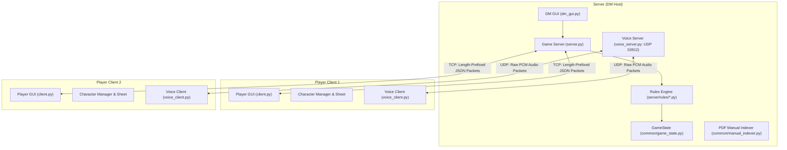

# D&D OmniCompanion — Operational Guide & System Manual

Welcome to the comprehensive operational manual for **D&D OmniCompanion**, a complete Virtual Tabletop (VTT) and campaign companion engine built in Python for Dungeons & Dragons 5th Edition.

---

## Table of Contents
1. [Architecture & Network Model](#1-architecture--network-model)
2. [Prerequisites & Quick Start](#2-prerequisites--quick-start)
3. [User Interface & Layout Overview](#3-user-interface--layout-overview)
4. [Dungeon Master (DM) Operations](#4-dungeon-master-dm-operations)
   - [Map Management & Hex Grid](#map-management--hex-grid)
   - [Fog of War, Dynamic Lighting & Line of Sight](#fog-of-war-dynamic-lighting--line-of-sight)
   - [Traps, Hazards & Portals (Teleports)](#traps-hazards--portals-teleports)
   - [Combat Management & Live Encounter Balancer](#combat-management--live-encounter-balancer)
   - [Monster Bestiary & Offline PDF Indexer](#monster-bestiary--offline-pdf-indexer)
   - [Handouts & Clue Sharing](#handouts--clue-sharing)
   - [Campaigns, Scenes, Shops & Quests](#campaigns-scenes-shops--quests)
   - [Party Management & Loot Splitting](#party-management--loot-splitting)
   - [Audio Soundboard](#audio-soundboard)
5. [Player Operations](#5-player-operations)
   - [Character Creation & Progression Wizard](#character-creation--progression-wizard)
   - [Interactive Character Sheet](#interactive-character-sheet)
   - [Combat Actions & 5e Turn Flow](#combat-actions--5e-turn-flow)
   - [Death Saving Throws Automation](#death-saving-throws-automation)
   - [Inventory & Encumbrance Grid](#inventory--encumbrance-grid)
   - [Spellbook & Spell Slot Management](#spellbook--spell-slot-management)
   - [Peer-to-Peer Player Trading](#peer-to-peer-player-trading)
   - [Hotbar Quick Macros](#hotbar-quick-macros)
   - [Travel System & Marching Order](#travel-system--marching-order)
6. [5e Mechanics & Automation Engine](#6-5e-mechanics--automation-engine)
   - [Advantage & Disadvantage Computation](#advantage--disadvantage-computation)
   - [Dynamic Cover System](#dynamic-cover-system)
   - [Opportunity Attacks](#opportunity-attacks)
   - [Concentration Checks](#concentration-checks)
   - [Damage Absorption, Resistances & Rage](#damage-absorption-resistances--rage)
   - [Resting & Hit Dice](#resting--hit-dice)
7. [Communication & Voice Chat](#7-communication--voice-chat)
   - [Discord-Styled Rich Chat](#discord-styled-rich-chat)
   - [Private Whispers](#private-whispers)
   - [Integrated UDP Voice Chat](#integrated-udp-voice-chat)
8. [Chat Commands & Hotkeys Reference](#8-chat-commands--hotkeys-reference)
9. [Bilingual Internationalization (IT / EN)](#9-bilingual-internationalization-it--en)
10. [Testing Suite & Quality Assurance](#10-testing-suite--quality-assurance)

---

## 1. Architecture & Network Model

D&D OmniCompanion is structured around an asynchronous Client-Server architecture combining reliable TCP state management with low-latency UDP voice streaming.



### Core Subsystems
* **`common/network_utils.py` & `common/protocol.py`**: Custom binary-length-prefixed framing over TCP socket streams, ensuring zero JSON chunk fragmentation regardless of network latency or payload size.
* **`common/hex_utils.py`**: Cubic coordinate system ($q, r, s$ where $q + r + s = 0$) for high-precision distance calculations, line of sight (LoS) raycasting, cone projection ($60^\circ / 90^\circ$), spheres, and straight-line AoEs.
* **`server/rules/`**: Decoupled 5e rule modules isolating combat, movement, character damage/death, chat commands, conditions, and hazards.
* **`common/i18n.py`**: Real-time bilingual translation dictionary supporting instantaneous language swapping between Italian and English across all GUI components and chat messages.

---

## 2. Prerequisites & Quick Start

### Requirements
* **Python 3.9+** (tested and verified up to Python 3.14).
* Core dependencies:
  ```bash
  pip install pillow ttkbootstrap requests sounddevice numpy
  ```
  *(Note: `sounddevice` and `numpy` are used for real-time voice streaming. In headless test environments or systems without PortAudio, the environment variable `DND_MOCK_AUDIO=1` is automatically honored).*

### Launching the Application
Execute the unified launcher from the project root:
```bash
python main.py
```
A role selector modal appears:
1. **Ospita Partita (Dungeon Master)**: Launches the DM Host server on default port `53911` (TCP) and `53912` (UDP) and opens the DM workspace.
2. **Unisciti alla Partita (Giocatore)**: Launches the Player VTT client, allowing character selection/creation and server connection via IP/hostname.

---

## 3. User Interface & Layout Overview

Both the DM and Player interfaces are built with **ttkbootstrap** in modern dark fantasy styling, organized into a 3-column layout inspired by modern VTTs and Discord:

| Column | Component | Purpose |
|---|---|---|
| **Left Toolbar** | Compact Icon Strip | Context-sensitive map tools (`👆` Select/Center, `📏` Ruler, `💥` Area of Effect, `🚪` Teleport, `☁️` Fog of War, etc.) with tooltips. |
| **Center Viewport** | `HexMapCanvas` | Infinite zoom & pan interactive hex canvas rendering background maps, dynamic Fog of War, lighting halos, auras, tokens, condition badges, walls, and ruler vectors. |
| **Right Sidebar** | Tabbed Notebook | Tabs for Chat / Dice Log, Voice Controls, Party & NPC Tracker, Bestiary, Inventory, Spellbook, Audio, and Travel. |

---

## 4. Dungeon Master (DM) Operations

### Map Management & Hex Grid
* **Loading Maps**: Navigate to `File -> Apri Mappa` (or `Open Map`). Supported formats: `.png`, `.jpg`, `.jpeg`.
* **Map Editor**: Choose `Strumenti -> Editor Mappe` to configure:
  * Hex grid radius and offset.
  * Static collision walls (blocks movement and Line of Sight).
  * Traps and secret triggers.
  * Teleportation points between different map files.
  * Pre-placed Points of Interest (POIs).

### Fog of War, Dynamic Lighting & Line of Sight
* **Dynamic Fog of War (FoW)**: The canvas automatically conceals unexplored hexes for players.
* **Shared Party Vision**: As any party token moves, hexes within its vision radius are revealed.
* **Dynamic Lighting**: Tokens carrying light sources (e.g., Torches: 20 ft bright / 20 ft dim; Lanterns: 30 ft bright / 30 ft dim) illuminate hexes dynamically for all players in real time.
* **True Line of Sight (LoS)**: Hex raycasting evaluates line-of-sight against walls (`wall_hexes`). Tokens behind impenetrable walls cannot be seen or targeted through FoW.

### Traps, Hazards & Portals (Teleports)
* **Traps**: When a token enters a trap hex, the server:
  1. Checks Passive Perception against the trap's Detection DC.
  2. If triggered, rolls damage and prompts the player for a Dexterity Saving Throw.
  3. Reveals the trap visually on the map with an alert in chat.
* **Portals & Teleports**: Clicking `[ 🚪 ]` on the DM toolbar allows binding an hex coordinate (e.g., `5,5`) to a destination map file (e.g., `dungeon_level2.json`). When a token steps on the hex, the server automatically transitions the party to the new map.

### Combat Management & Live Encounter Balancer
1. **Starting Combat**: Select targets or click **Inizia Combattimento** (Start Combat) in the `Iniziativa & PG` tab.
2. **Mass NPC Initiative**: The DM can click **Tira Iniziativa Mostri** to instantly roll initiative for all monsters in the encounter simultaneously with Dexterity modifiers applied.
3. **Turn Cycling**: Use **Prossimo Turno** (Next Turn) or **Precedente** to advance the initiative order. The active token is highlighted with a gold ring on the map, and a non-blocking toast notification announces their turn.
4. **Live Encounter Difficulty Calculator (DMG p. 82)**:
   * The DM panel dynamically tallies total player levels and monster challenge ratings (CR).
   * Calculates adjusted encounter XP using 5e monster count multipliers (from $1.5\times$ to $4\times$).
   * Displays real-time difficulty: **Banale (Trivial)**, **Facile (Easy)**, **Medio (Medium)**, **Difficile (Hard)**, or **Mortale (Deadly)**.
5. **Boss Mechanics & Legendary Actions**:
   * **Legendary Resistances**: Monsters with legendary resistance (e.g., 3/day) can turn a failed saving throw into a success with 1 click.
   * **Legendary Actions**: Spend legendary action points outside the boss's turn, resetting automatically at the start of each round.

### Monster Bestiary & Offline PDF Indexer
* **Online SRD Bestiary**: Search monsters by name via Open5e/D&D 5e API.
* **Offline PDF Indexer**: Click **Cerca in PDF** to search offline directly inside official rulebook PDFs (Monster Manual, Player's Handbook, Dungeon Master's Guide) cached in `manuals/pdf_index_cache.json`.
* **One-Click Spawn**: Click **Spawna sulla Mappa** to instantly place the monster token at the last clicked hex with complete HP, AC, speed, actions, and initiative stats.

### Handouts & Clue Sharing
* Open `Strumenti -> Condividi Documento (Handout)`.
* Enter a title and text (e.g., ancient letter, cipher, map fragment).
* Broadcasts immediately to all connected clients, popping up an authentic dark fantasy parchment modal dialog.

### Campaigns, Scenes, Shops & Quests
* **Campaign & Scene Manager**: Prepare encounters in advance as "Scenes" linked to specific maps and tokens. Switch scenes seamlessly during live play without manual re-placement.
* **Shop & Economy System**: Open merchant stores where players can browse goods, check inventory weight, and purchase gear deducted directly from their gold pieces.
* **Quest Log**: Track Active, Completed, and Failed quests with milestone rewards.

### Party Management & Loot Splitting
* **Party vs NPC Separation**: In out-of-combat mode, the DM listbox separates players into `--- PARTY ---` and `--- NPC ---`. Right-click any entity to toggle party status.
* **Loot Splitter**: Click **Dividi Denaro** and enter an amount of Gold Pieces (GP). The server divides the gold evenly among all active party members and updates their character sheets automatically.

### Audio Soundboard
* The `Audio/Sfx` tab provides instant atmospheric soundscape broadcast buttons (e.g., Tavern, Battle, Dungeon Ambience) played synchronously on client browsers/media players.

---

## 5. Player Operations

### Character Creation & Progression Wizard
* Accessible via `Libreria -> Creazione Personaggio` or the Level-Up button.
* **Baldur's Gate Styled UI**: Step-by-step guidance for class, race, ability scores (Standard Array, Point Buy, or Custom Rolls), starting gear, and background features.
* **Level-Up Wizard**:
  * Calculates HP gain (Hit Die roll or fixed average).
  * Automatically fetches class features from the 5e SRD for the new level.
  * Handles Ability Score Improvements (ASI) or Feats.
  * Unlocks new spell slots.

### Interactive Character Sheet
Organized in clean tabs:
* **Combat Tab**: Current/Max HP, Temp HP, Armor Class, Speed, Initiative bonus, Active Conditions with visual status badges, Death Saves, Hit Dice tracker.
* **Stats & Skills Tab**: Six core ability scores, saving throw proficiencies, passive perception, and all 18 skill proficiencies with automatic modifier computation.
* **Inventory Tab**: Grid-based inventory with item weights, quantity, attuned items, and total weight vs carrying capacity ($\text{STR} \times 15\text{ lbs}$).
* **Spellbook Tab**: Level 1 to 9 spell slots with current/max counters, spell search, and 1-click casting with automatic slot deduction.
* **Features & Traits**: Racial traits, class privileges, feats, and custom notes.

### Combat Actions & 5e Turn Flow
When combat starts and your turn arrives:
1. **Turn Notification**: Visual banner and toast appear ("È IL TUO TURNO!").
2. **Move**: Click on the destination hex (movement path is validated against remaining speed; Prone condition doubles movement cost).
3. **Action Menu**: Click `Azione` to choose standard 5e actions:
   * **Attacco (Attack)**: Select weapon, pick target on map with 1 click.
   * **Lancia Incantesimo (Cast Spell / AoE)**: Open AoE tool, select template (Sphere, Cone, Line), choose radius/length, and place on hex grid.
   * **Scatto (Dash)**: Doubles current speed for the turn.
   * **Disimpegno (Disengage)**: Prevents triggering opportunity attacks during movement.
   * **Schivata (Dodge)**: Gives attackers disadvantage until the start of your next turn.
   * **Aiuto (Help)**: Gives an ally advantage on their next attack roll against a nearby enemy.
4. **End Turn**: Click `Termina Turno` to pass initiative to the next combatant.

### Death Saving Throws Automation
* If you start your turn at **0 HP**:
  * A Death Save prompt opens automatically. You can also roll with `/tsmorte`, `/deathsave`, or `/ds`.
  * **Natural 20**: Regain 1 HP immediately, stand up, and clear the `Incosciente` (Unconscious) condition.
  * **Roll $\ge 10$**: +1 Success (at 3 successes, you gain the `Stabilizzato` condition).
  * **Roll $< 10$**: +1 Failure.
  * **Natural 1**: Counts as **2 Failures** (at 3 failures, you gain the `Morto` condition).
* **Taking Damage at 0 HP**: Automatically marks a failure (or 2 if a critical hit). Excessive damage exceeding your Max HP causes instant death.

### Inventory & Encumbrance Grid
* Real-time weight tracking:
  $$\text{Carrying Capacity} = \text{Strength} \times 15\text{ lbs}$$
* If total inventory weight exceeds carrying capacity, the weight counter turns red with an **Ingombrato (Encumbered)** warning.

### Spellbook & Spell Slot Management
* Add spells using the built-in SRD browser.
* Clicking **Lancia** (Cast) checks if a slot is available, decrements the slot, announces the spell in chat, and prompts saving throws or damage rolls to affected targets.
* **Long Rest** restores all spell slots to maximum.

### Peer-to-Peer Player Trading
* Open player trade via the context menu.
* Select items and gold to offer. Both players review the offer and click **Conferma Scambio** to atomically execute the trade without DM intervention.

### Hotbar Quick Macros
* 10 customizable quick slots at the bottom of the player panel.
* **Right-Click Slot**: Configure macro command (e.g., `/roll 1d20+5 Spada Lunga`, `/ds`, `/tsmorte`).
* **Left-Click Slot**: Instantly executes the macro in chat.

### Travel System & Marching Order
* Set party marching order: **Avanguardia (Front)**, **Centro (Middle)**, **Retroguardia (Rear)**.
* Assign travel roles: Navigator, Scout, Forager.
* Ration and water tracking with automated starvation/exhaustion penalties.
* Forced March calculation with progressive Constitution saving throw DCs ($10 + 1\text{ per hour past 8}$).

---

## 6. 5e Mechanics & Automation Engine

### Advantage & Disadvantage Computation
The combat engine calculates advantage and disadvantage dynamically based on token states:
* **Attacker gains Advantage if**:
  * Attacker is `Invisibile`.
  * Target is `Trattenuto`, `Paralizzato`, `Incosciente`, `Accecato`, or `Pietrificato`.
  * Target is `Prono` AND attack is melee (distance $\le 1$ hex).
* **Attacker suffers Disadvantage if**:
  * Attacker is `Accecato`, `Avvelenato`, `Trattenuto`, or `Prono`.
  * Target is `Prono` AND attack is ranged (distance $> 1$ hex).
  * Target is `Invisibile`.
  * Target took the `Schivata` (Dodge) action.
* **Mutual Cancellation**: Having both advantage and disadvantage resolves to a normal roll as per 5e rules.

### Dynamic Cover System
* If another creature or obstacle lies directly on the hex ray between the attacker and target, the target gains **Mezza Copertura (+2 CA)** automatically.

### Opportunity Attacks
* When a token moves out of an adjacent enemy's melee reach (1 hex) without having used the **Disengage** action, the server detects an opportunity attack opening and alerts the DM/attacker.

### Concentration Checks
* When a creature with the `Concentrazione` condition takes damage, the server automatically prompts a Constitution Saving Throw:
  $$\text{DC} = \max(10, \lfloor\text{Damage} / 2\rfloor)$$
* On failure, `Concentrazione` is automatically removed and announced in chat.

### Damage Absorption, Resistances & Rage
* **Temporary Hit Points (Temp HP)**: Absorbs damage first before real HP is decreased.
* **Damage Types & Resistances**: Damage reduction (half) or immunity (zero) is automatically calculated if resistance or immunity tags match the damage type.
* **Barbarian Rage**: Resistance to bludgeoning, piercing, and slashing damage is applied when in Rage.

### Resting & Hit Dice
* **Short Rest**: Spend available Hit Dice to regain HP ($\text{Die Roll} + \text{CON mod}$ per die); resets short-rest class features (e.g., Action Surge, Ki points, Warlock slots).
* **Long Rest**: Restores full HP, regains half of total Hit Dice, clears 1 level of exhaustion, and restores all spell slots.

---

## 7. Communication & Voice Chat

### Discord-Styled Rich Chat
* Formatted message view with timestamps, distinct color tags for DM announcements, combat logs, damage rolls, and player messages.
* Native rich markdown rendering with collapsible dice results.

### Private Whispers
* Use `/w <CharacterName> <Message>` (or `/whisper`, `/sussurra`).
* Whispers are routed strictly between the sender and the recipient with a `[🔒 Sussurro]` prefix.

### Integrated UDP Voice Chat
* High-performance, low-latency audio transmission directly inside the VTT without external third-party software.
* Microphone mute (`[ 🎤 ]`) and audio deafen (`[ 🎧 ]`) controls directly on the chat bar.
* Safe fallback in environments without physical audio hardware.

---

## 8. Chat Commands & Hotkeys Reference

### Chat Commands

| Command | Description | Example |
|---|---|---|
| `/roll <expr>` or `/r <expr>` | Rolls dice with arithmetic | `/roll 2d6+4`, `/r 1d20+7` |
| `/w <name> <msg>` | Sends private whisper | `/w Gildor Guarda dietro di te` |
| `/whisper <name> <msg>` | Alias for private whisper | `/whisper DM Ho trovato la chiave` |
| `/sussurra <name> <msg>` | Italian alias for whisper | `/sussurra Elidor Ho 3 slot rimasti` |
| `/manuale <termine>` | Quick lookup in indexed 5e rulebooks | `/manuale fireball`, `/manuale stealth` |
| `/rule <termine>` | Alias for manual lookup | `/rule grappling` |
| `/tsmorte`, `/deathsave`, `/ds` | Roll 5e Death Saving Throw | `/ds` |
| `/vision <name> <radius>` | DM only: sets character darkvision radius | `/vision Gildor 12` |

### Canvas & Hotkey Controls

| Action | Control | Description |
|---|---|---|
| **Pan Map** | Right-Click + Drag or Middle-Click + Drag | Smooth canvas viewport navigation. |
| **Zoom Map** | Mouse Wheel Up / Down | Zooms in/out centered on cursor. |
| **Move Token** | Left-Click + Drag on Token | Moves active token along valid hex paths. |
| **Ping Map** | Middle-Click on Hex | Sends animated ping marker to all players. |
| **Measure Distance** | Click `[ 📏 ]` then Drag | Measures distance in hexes and feet ($5\text{ ft/hex}$). |
| **Target Select** | Click `[ 👆 ]` then Click Target | Targets token for 1-click attack or spell. |
| **Place AoE** | Click `[ 💥 ]` then Click Origin Hex | Previews and drops spell template. |

---

## 9. Bilingual Internationalization (IT / EN)

D&D OmniCompanion features full live bilingual localization:
* Switch languages at runtime from the top menu bar (`Lingua / Language -> Italiano / English`) without restarting the server or client.
* Translates UI controls, menu items, condition badges, skills, abilities, combat toasts, and system messages.

---

## 10. Testing Suite & Quality Assurance

The codebase includes automated test suites covering headless unit tests, GUI smoke tests, and full multiplayer simulation:

```powershell
# Run the complete 53-phase multiplayer game simulation
$env:DND_MOCK_AUDIO="1"; python simulate_game_session.py

# Run unit tests for recent features (ruler, whispers, death saves, handouts)
$env:DND_MOCK_AUDIO="1"; python -m unittest test_new_features.py

# Run campaign and UI smoke tests
$env:DND_MOCK_AUDIO="1"; python -m unittest test_campaign_system.py test_ui_smoke.py
```

All 53 phases pass with **0 failures**, validating end-to-end reliability across network sockets, combat mechanics, and graphical rendering.
